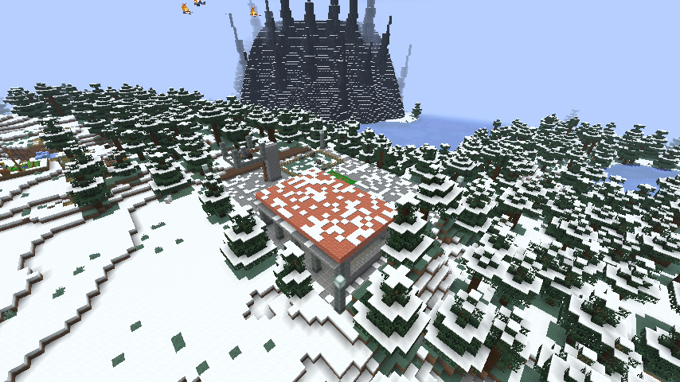
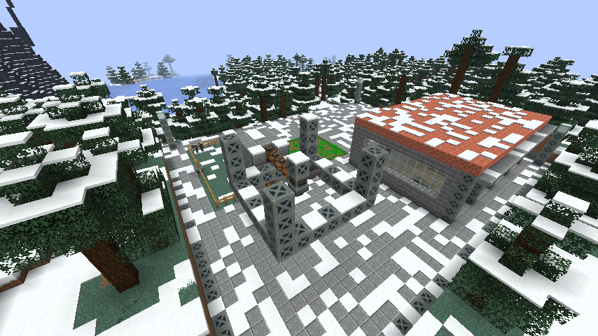
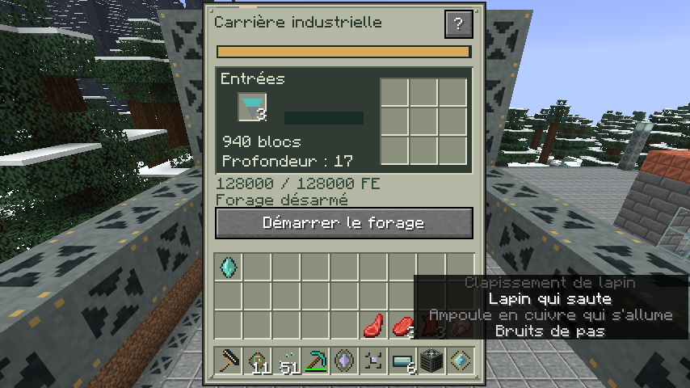
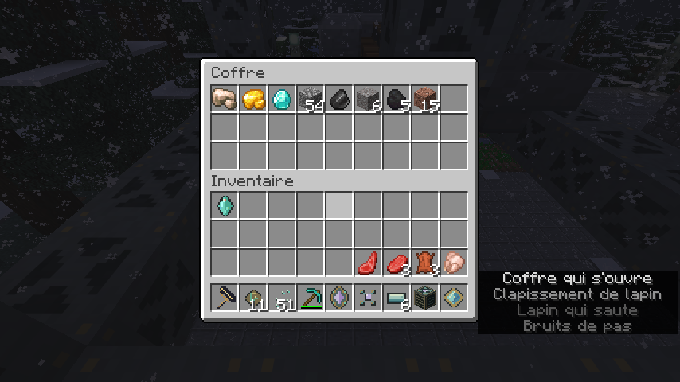
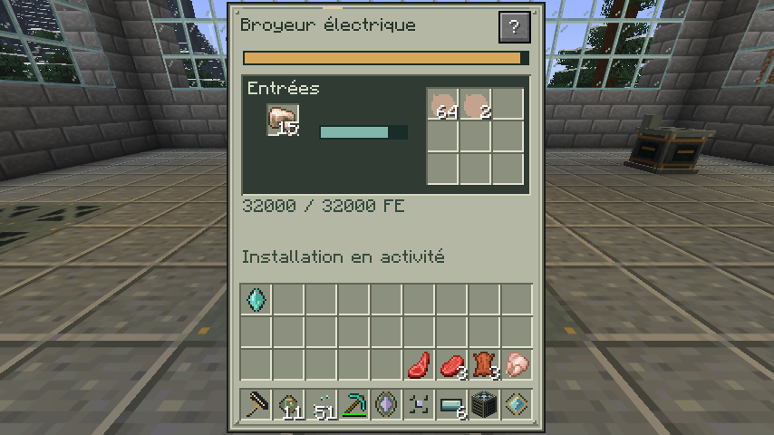
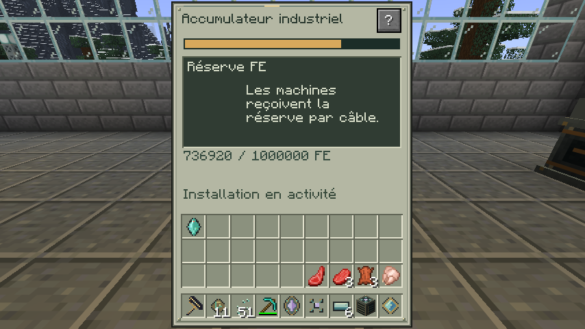
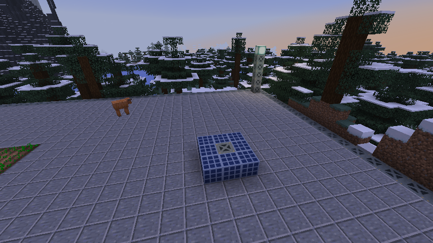
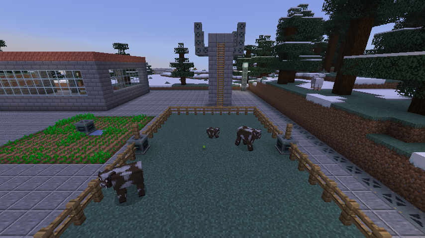
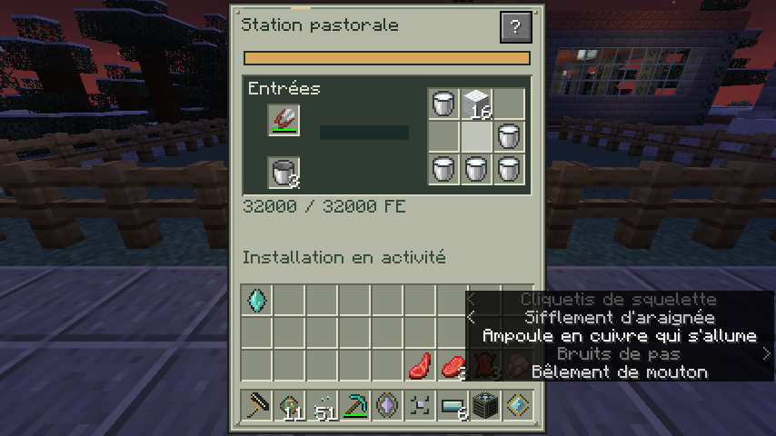
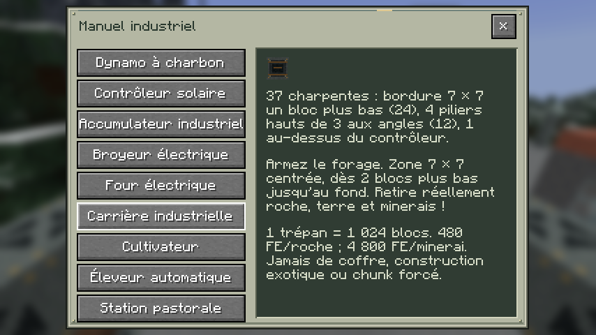

# The New Dimension 0.10 — L’âge industriel

[JAR NeoForge 26.2](tnd-0.10.0-dev.jar) · [Guide industriel](docs/INDUSTRY_0.10.0.md) · [Validation](VALIDATION-0.10.0.txt)

Captures natives de Minecraft Java 26.2 / NeoForge 26.2.0.93, en français, sans retouche d’image. L’atelier est une installation de contrôle préparée en Créatif : terrain modifié, animaux et matériaux placés, réserve d’énergie initialisée. Les prises de vue aériennes utilisent le mode Spectateur. Ce bâtiment de démonstration n’est pas une structure générée par le mod ; le massif en arrière-plan appartient au contenu de la 0.9.

## Une installation dans l’Overworld

## Le derrick de la carrière

37 charpentes sont nécessaires. Le support central est au-dessus du contrôleur pour laisser la sortie inférieure accessible aux entonnoirs.

Le coffre reçoit réellement les produits par l’entonnoir inférieur. Les trois premiers minerais avaient été placés pour l’essai ; la roche et le sol suivants sont excavés par la machine.

## Transformer et stocker

## Cultures et élevage

La petite centrale demande huit panneaux autour du contrôleur. Le cultivateur voisin récolte les plants mûrs et conserve une graine pour replanter.

L’éleveur met les parents en amour ; leur IA vanilla produit le veau visible dans l’enclos.

La station tond, trait et ramasse les vrais objets au sol. Les aliments et peaux dans l’inventaire du joueur ont été récupérés au cours de l’essai ; la station ne tue pas les animaux.

## Instructions accessibles dans le jeu

Inventaire → Guide → Industrie. Le bouton **?** de chaque machine ouvre aussi directement sa page. Les écrans sont ici vérifiés à 854 × 480.

