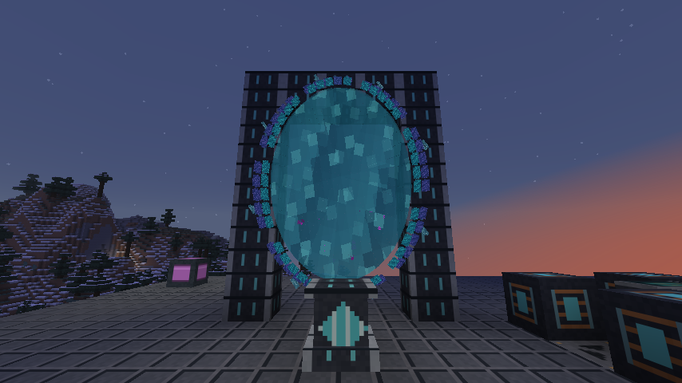
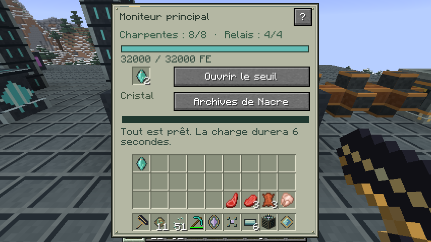
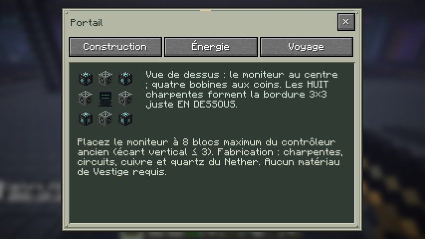
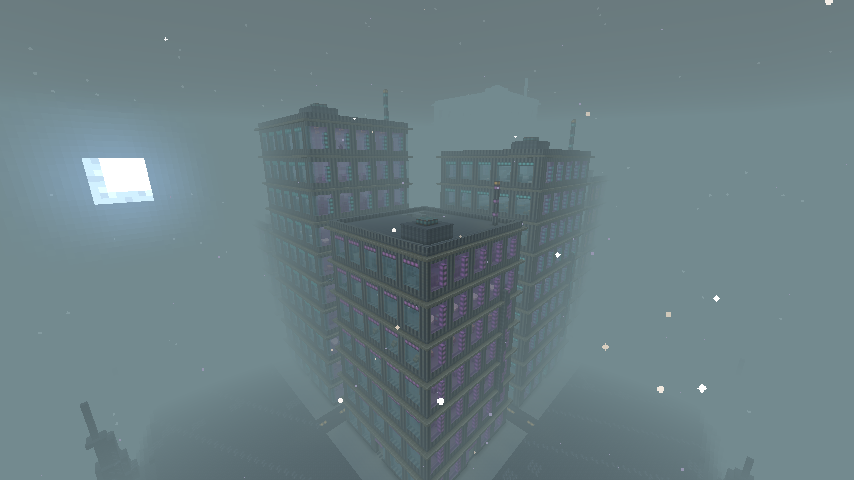
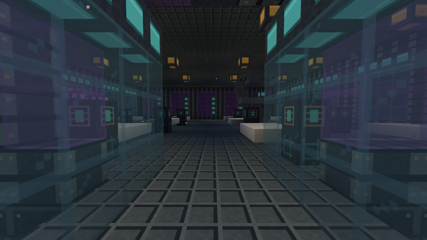
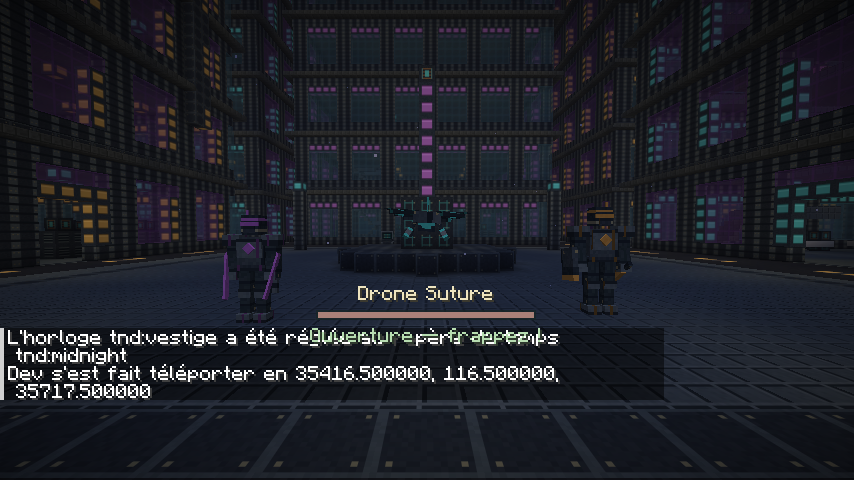
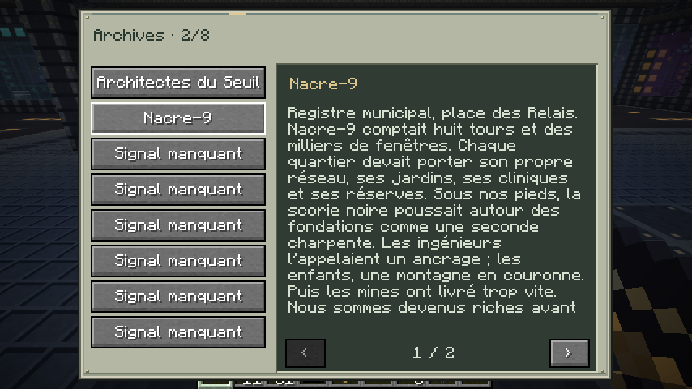
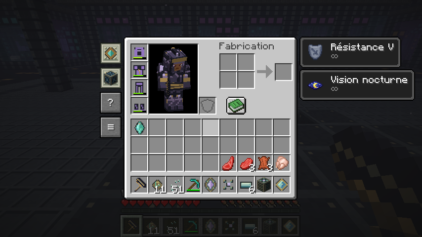

# Nacre-9 — captures natives de la 0.11.0-dev

Minecraft Java 26.2 / NeoForge 26.2.0.93. Images prises avec F2, sans retouche, en 854 × 480. La ville est générée naturellement dans une sauvegarde de contrôle ; les écrans et modèles sont montrés dans des scènes de vérification.

[Télécharger le JAR](tnd-0.11.0-dev.jar) · [Guide complet](docs/NACRE_0.11.0.md) · [Validation GitHub](https://github.com/axephir/TheNewDimension/actions/runs/39666790682)

## Le seuil déployé

Membrane animée, anneaux opposés, glyphes, particules et résonance. Installation construite dans la sauvegarde de contrôle.

## Moniteur principal

Pièces présentes, réserve FE, cristal réel, charge et archives. Ouverture réussie et aller-retour vérifiés dans le client.

## Montage guidé

Le guide intégré distingue les huit charpentes du niveau inférieur et les quatre relais au niveau du moniteur.

## Les tours de Nacre-9

Quartier généré naturellement dans le biome urbain de Vestige. Huit tours composent le quartier, sur un massif couronné de pics ; le brouillard masque une partie de la ville sur cette vue.

## Passerelle et intérieur

Une passerelle vitrée mène à un étage réellement aménagé. Les escaliers, coffres et terminaux utilisent les blocs natifs du jeu.

## Les trois défenses de Nacre

Faucheur de signal à gauche, Drone Suture au centre et Veilleur de néon à droite. Présentation des modèles avec IA immobilisée pour la capture ; les attaques, dégâts et esquives sont vérifiés séparément par les tests natifs.

## Les archives personnelles

Le terminal de la place a débloqué le deuxième récit. Textes paginés, découvertes sauvegardées, progression individuelle et mémorial unique.

## Onglets à gauche

Maîtrises, expéditions, guide et archives à gauche ; effets de potion à droite. Les effets affichés servent à vérifier la disposition de l’interface dans une scène de contrôle.

