# Symbiose — captures natives de la 0.12

Minecraft Java 26.2 / NeoForge 26.2.0.93. Captures **F2 sans retouche**, en 854 × 480, dans des sauvegardes de contrôle. Les vues extérieures montrent des portions de la métropole, dont le diamètre total est de 1 280 blocs ; la distance de rendu et le brouillard limitent ce qui apparaît à l’écran. Les installations de démonstration sont assemblées en créatif, l’ancre reçoit une réserve FE de contrôle et le familier adulte est configuré au niveau 20 pour examiner son modèle. Les combats et la progression réelle sont vérifiés séparément par les tests natifs.

[Télécharger le JAR](tnd-0.12.0-dev.jar) · [Guide](docs/SYMBIOSIS_0.12.0.md) · [Validation](VALIDATION-0.12.0.txt)

## Le nouveau seuil

Surface claire, contour fin, animation et particules. Le moniteur reste obligatoire pour la première ouverture.

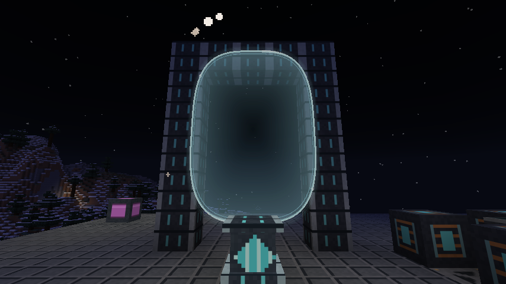

## Nacre, région urbaine continue

Tours, passerelles et niveaux aménagés, générés naturellement dans des secteurs inexplorés de Vestige.

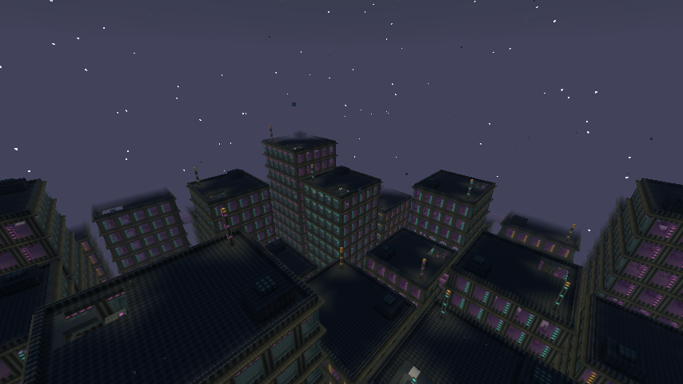

La couronne de pics noirs et les nervures du champ traversable entourent la ville.

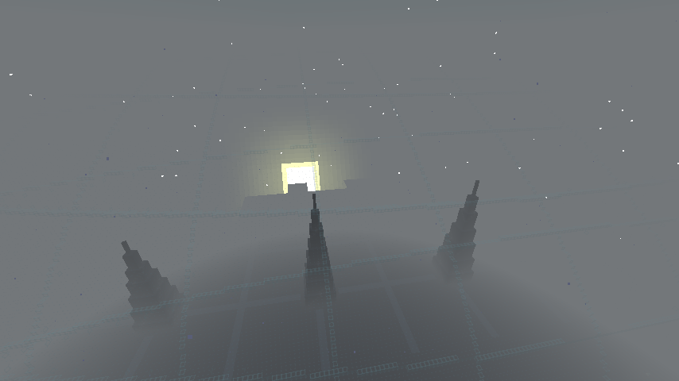

Vue de la voûte depuis l’intérieur. Le champ protège aussi le mobilier vanilla ; coffres, portes et terminaux restent utilisables.

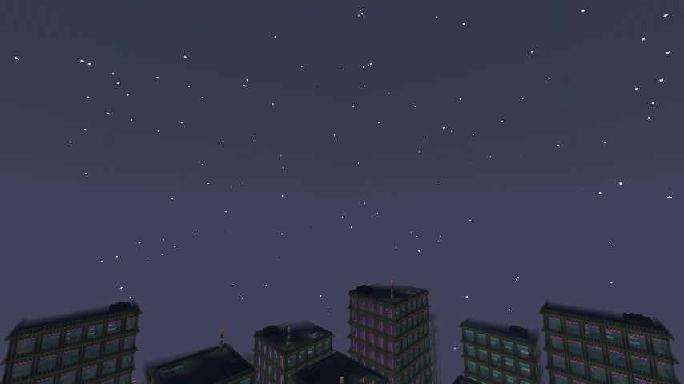

## Le lien de symbiose

La séquence de lien suit la libération de la capsule, le combat et le soin avec le nutriment du laboratoire.

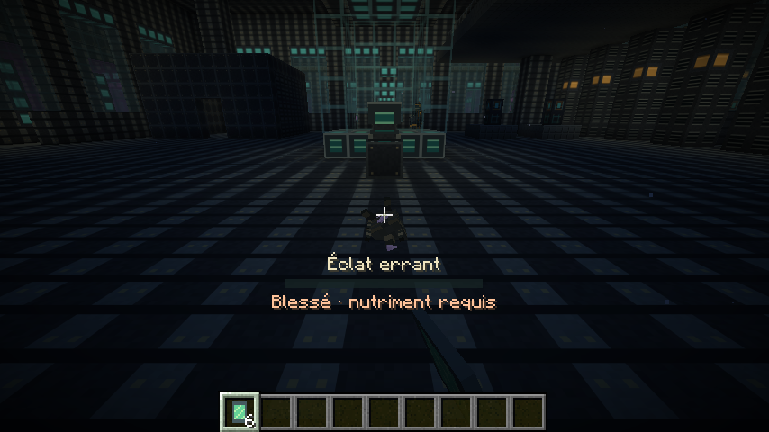

Dossier du même compagnon, renommé Aster dans le client. Son nom survit à la mise en capsule, au retour et au déploiement.

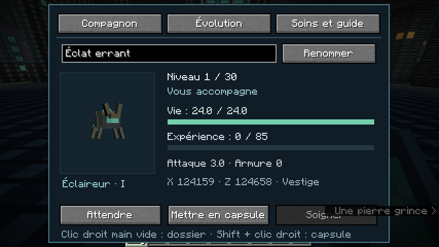

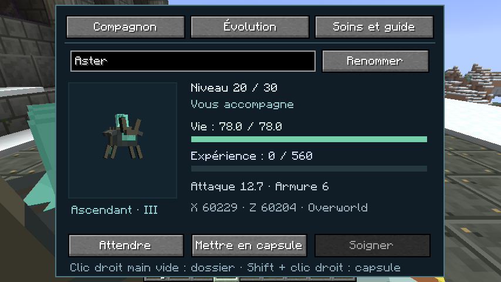

Les quatre aptitudes deviennent disponibles aux niveaux 3, 8, 12 et 20.

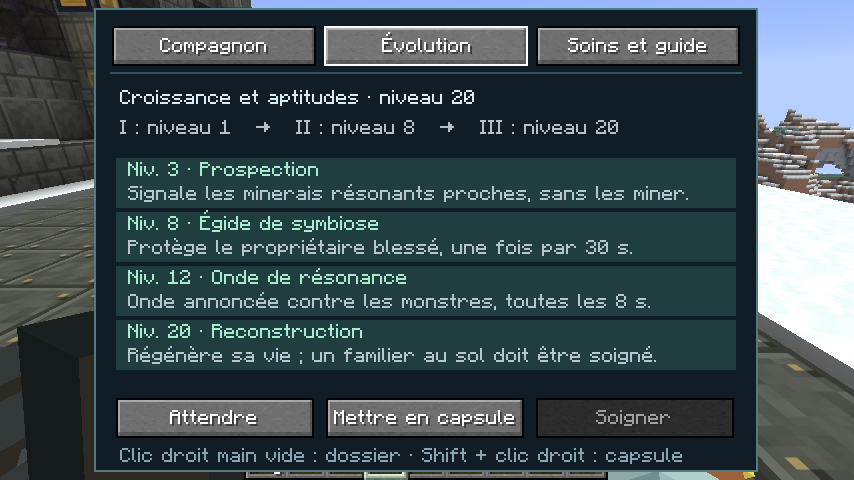

Le bouton des paramètres ouvre le dossier puis ramène aux options à sa fermeture.

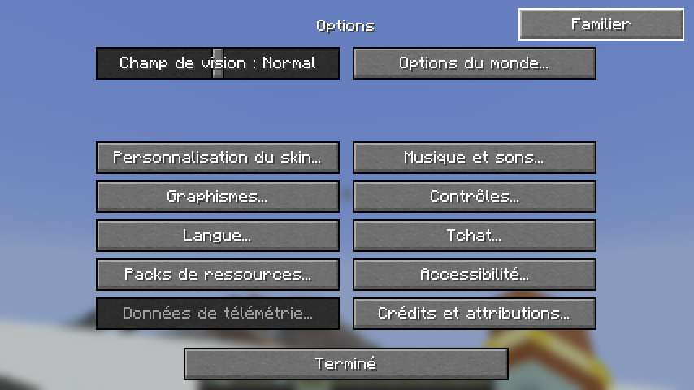

## Inventaire et atelier

Les cinq boutons sont à gauche ; les effets de potion gardent le côté droit.

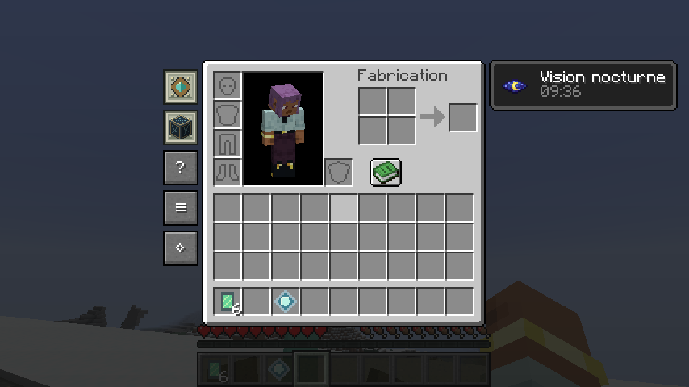

Le livre de recettes peut rester ouvert.

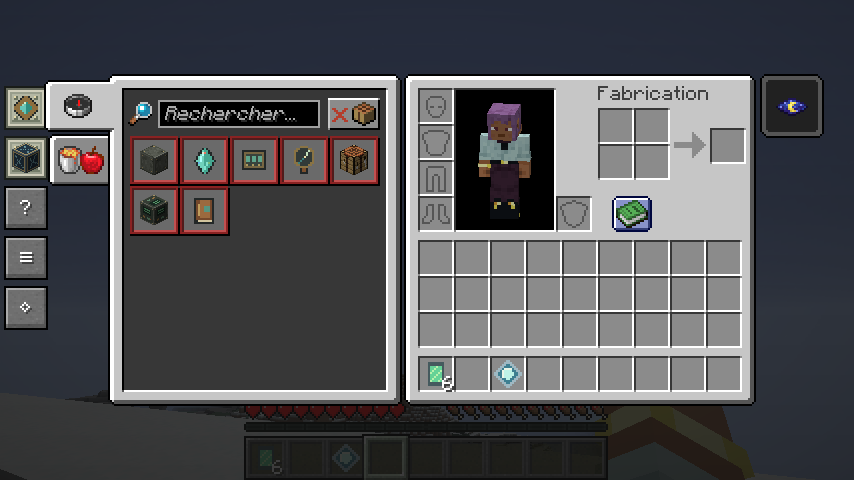

Ancre active : neuf secteurs maintenus, consommation réelle de 16 FE/t, propriétaire connecté et limite de deux ancres par joueur.

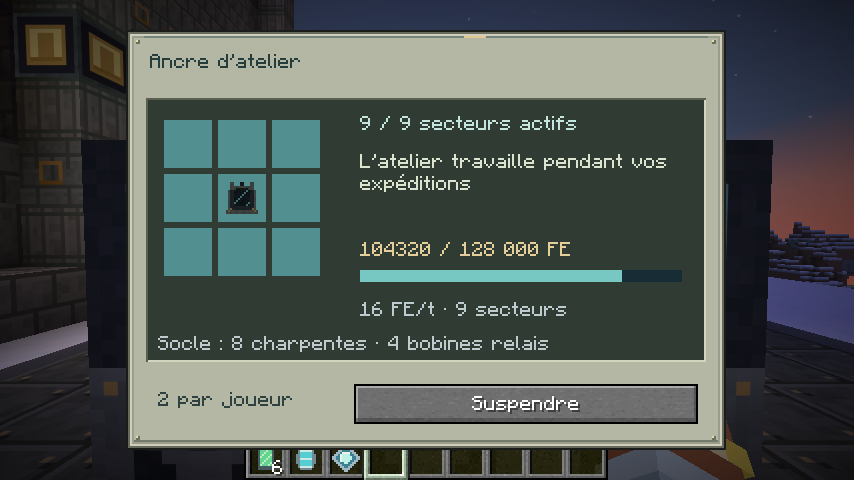

## Archives et conclusion — révélations scénaristiques

Afficher les captures du dénouement

Les huit archives personnelles préparent le dernier chapitre.

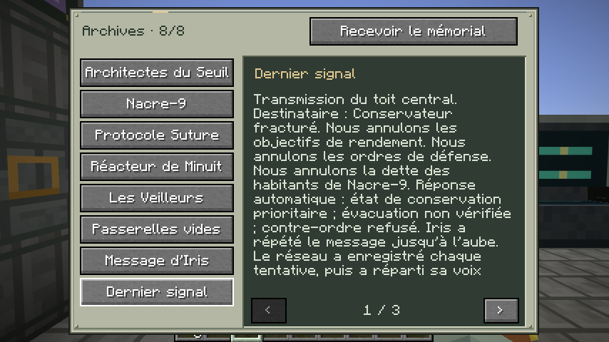

Le réacteur vérifie les archives et les deux assemblages avant de préparer la projection.

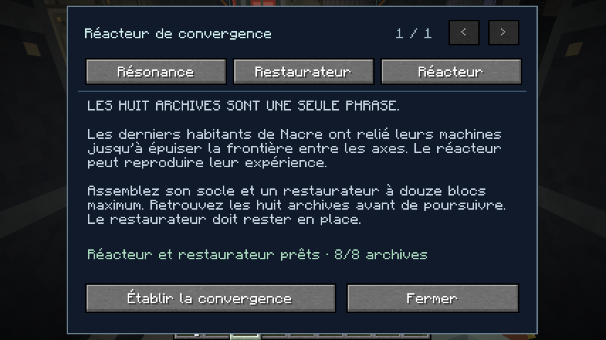

Courte caméra extérieure, impacts et fractures en hauteur, puis reprise du contrôle. Les blocs endommagés appartiennent uniquement à la copie de la base.

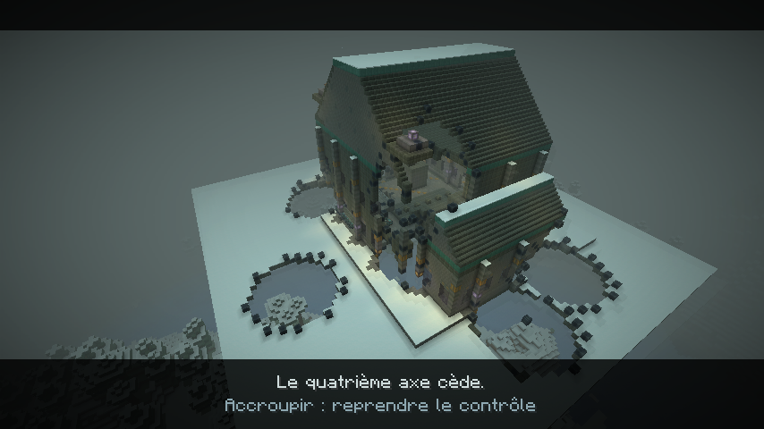

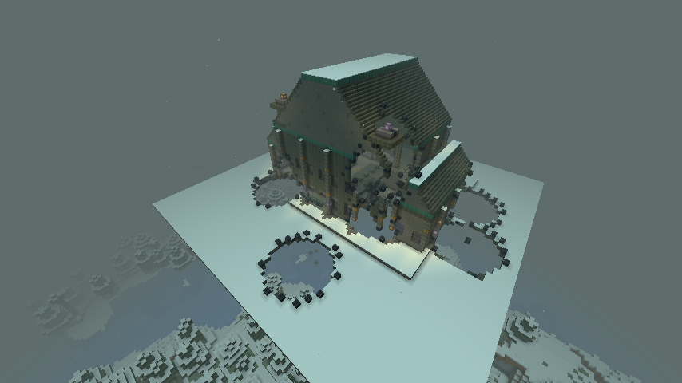

Refuser laisse explorer sans compte à rebours ; l’acceptation reste disponible ensuite.

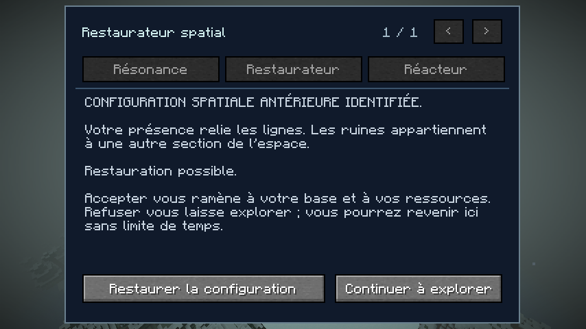

La base réelle et l’inventaire sont conservés au retour. La lentille reçue est liée au propriétaire ; sa présence désactive le bouton de réémission.

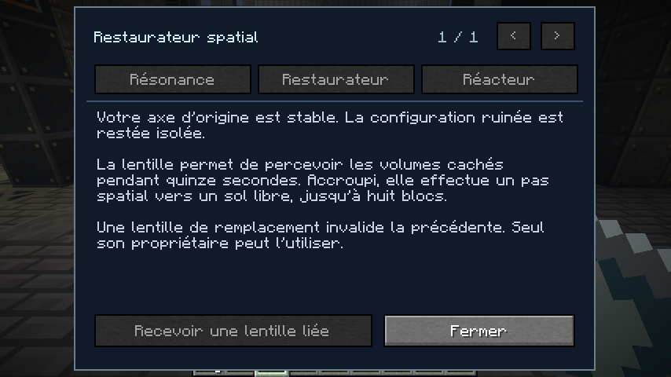

Volume caché rendu pendant la perception, présenté sur une installation de contrôle. Le laboratoire généré possède également ce volume.

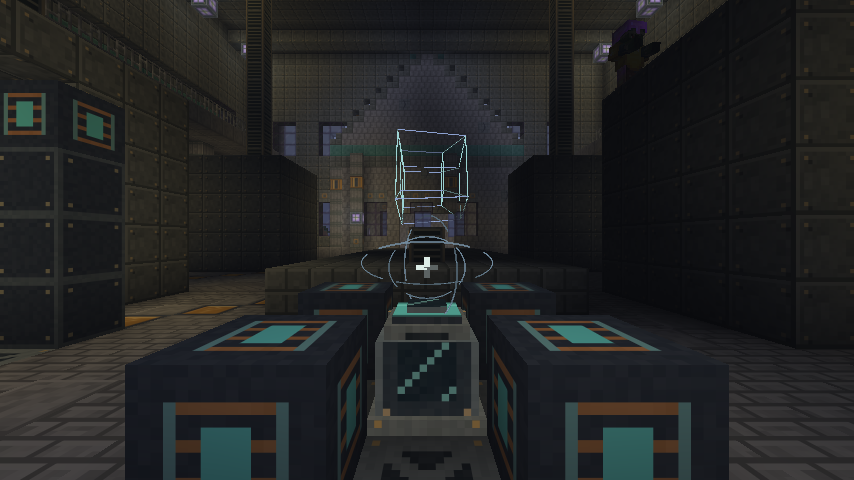

