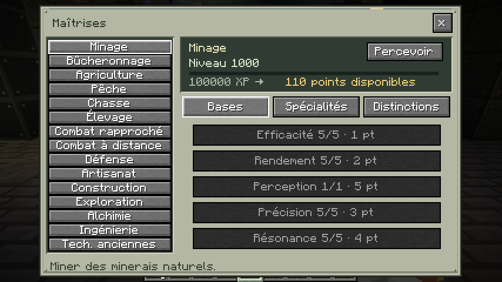
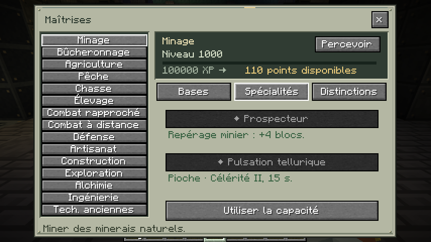
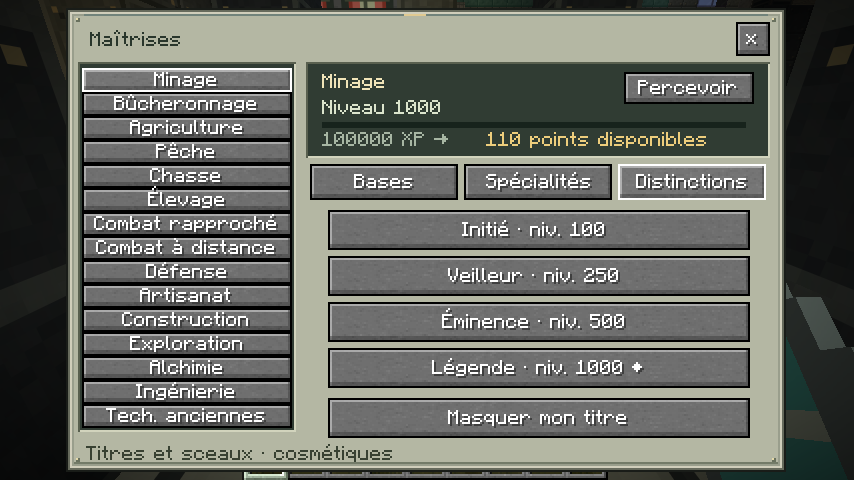
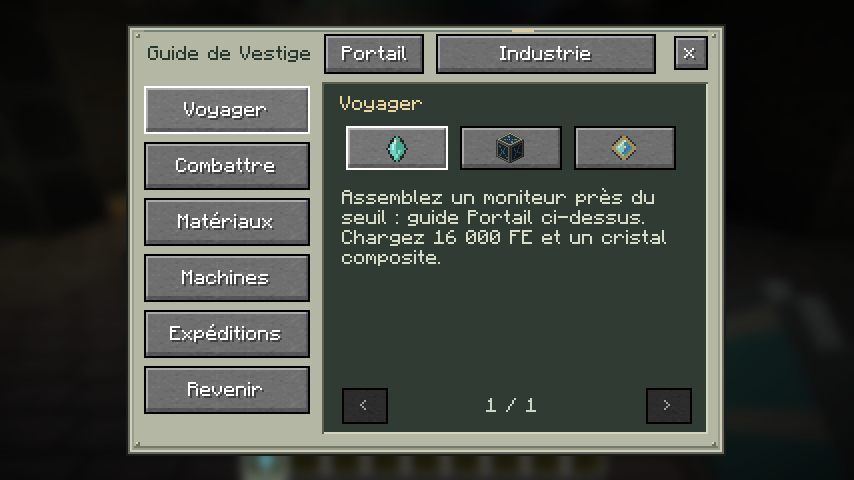
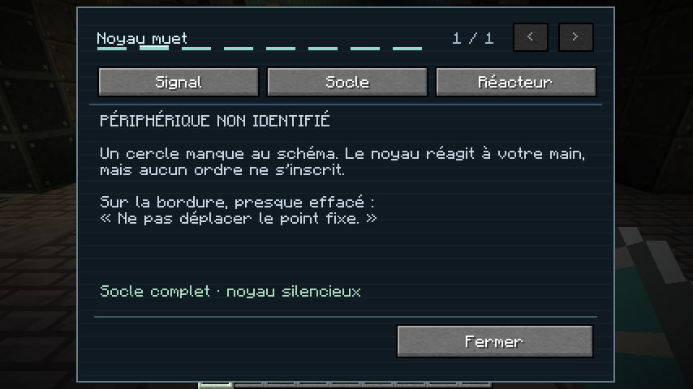
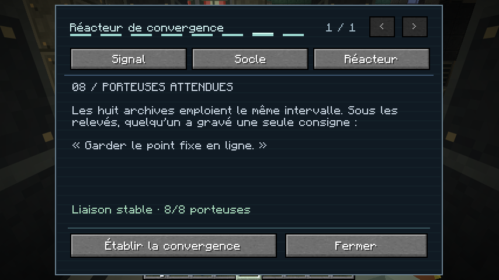
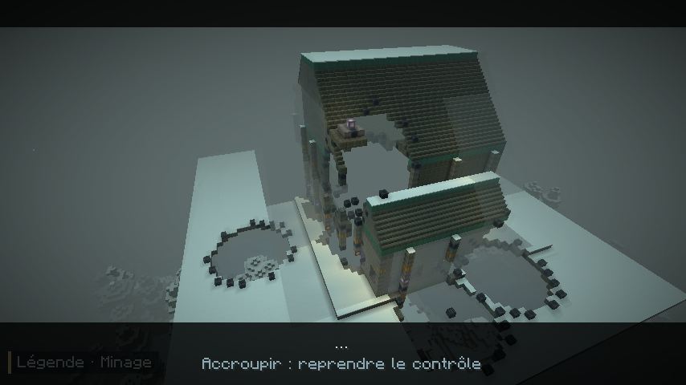
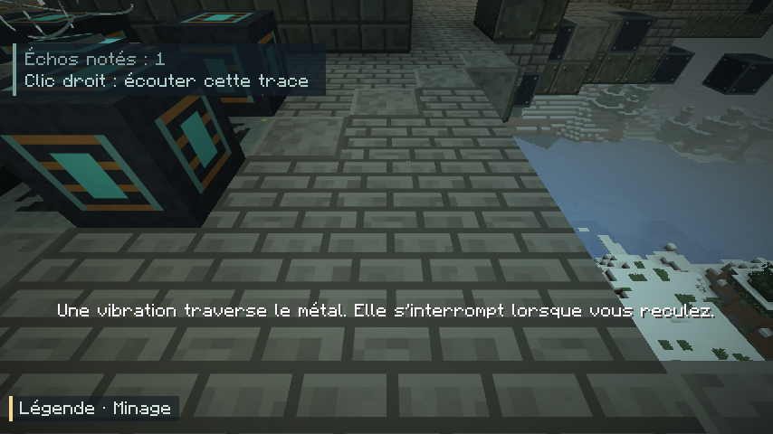
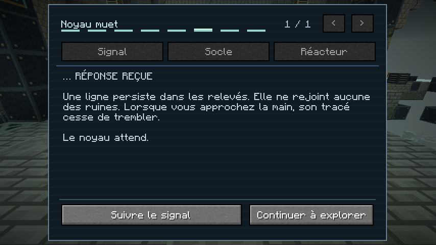

# 0.13 — Les traces muettes

Captures F2 du client Minecraft Java 26.2 / NeoForge 26.2.0.93, sans retouche. Monde de démonstration ; niveaux préréglés pour présenter les distinctions.

## Fondations et XP

## Spécialisations propres à chaque maîtrise

## Titres et sceaux décoratifs

## Guide complet et fiches accessibles

## Le noyau garde son mystère

## Des indices et des consignes séparés

Scène finale — contient des images à découvrir en jeu

### Le silence

### Écouter les traces

### Le choix

