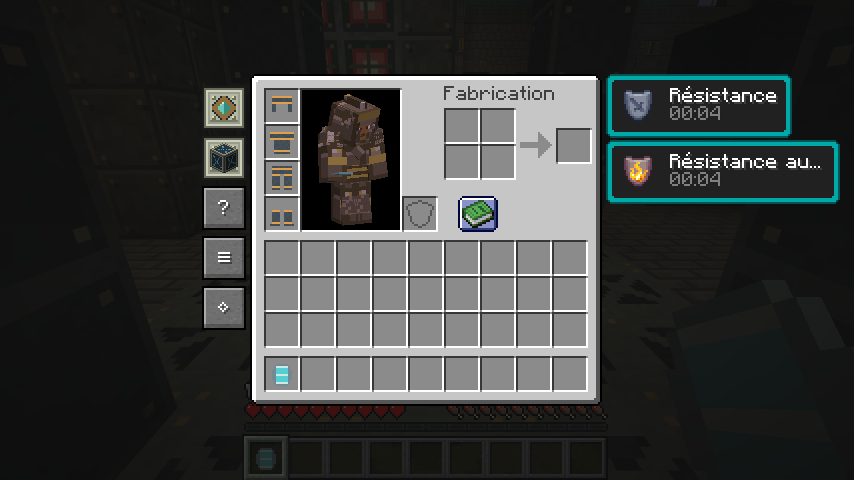
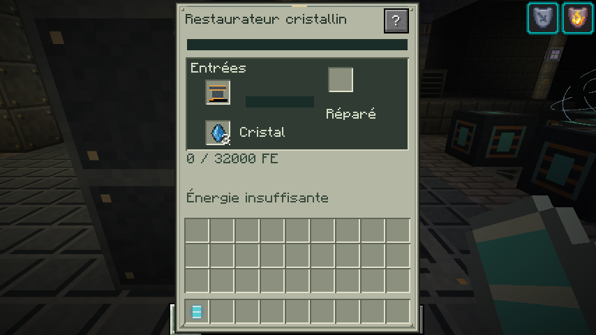
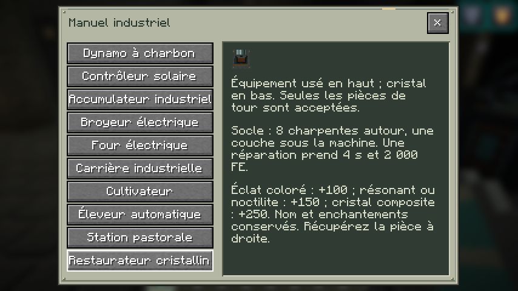
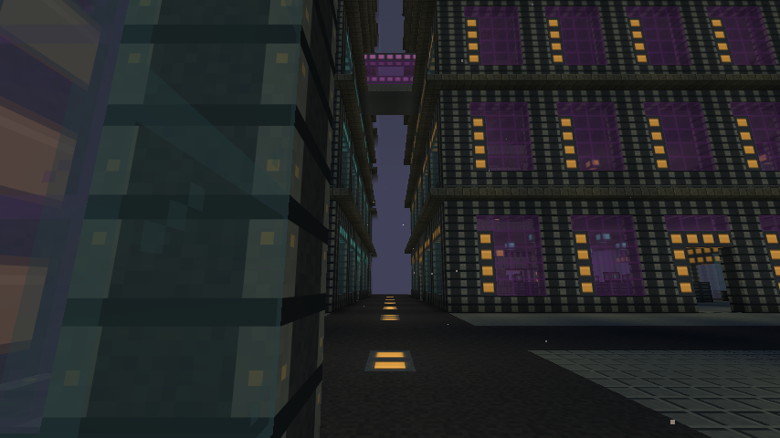
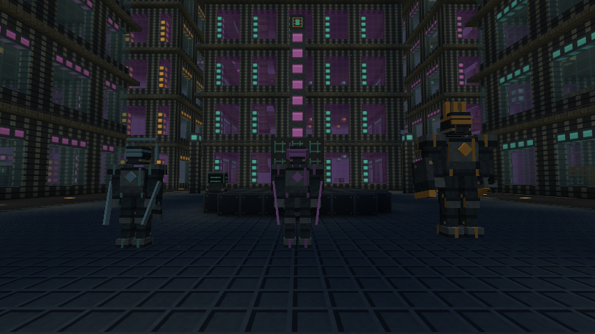

# 0.14 — Les tours de confinement

Captures F2 du client Minecraft Java 26.2 / NeoForge 26.2.0.93, sans retouche. Monde de démonstration isolé ; équipement et atelier préparés par commandes pour les contrôles visuels.

## Armure du Rempart et effets du set

L’avatar porte les quatre pièces en Survie/Pacifique. Les boutons TND restent à gauche de l’inventaire ; les effets vanilla restent à droite.

## Restaurateur cristallin

Pièce usée et cristaux visibles ; la machine indique ici l’absence d’énergie. Les réparations et les coûts sont également vérifiés dans les GameTests natifs.

## Guide de montage et de réparation

## Rue d’un quartier généré naturellement

Ville de Nacre visitée dans de nouveaux chunks de Vestige. La scène utilise le rendu logiciel du client cloud ; elle ne constitue pas une mesure générale de performances.

## Les trois mini-boss

Présentation des modèles en Créatif : les créatures ont été invoquées et immobilisées sur la place pour la capture. Les rencontres de jeu les libèrent aux sommets des tours.

De gauche à droite : Chirurgien du Chœur, Traqueur prismatique, Maréchal de Nacre.

