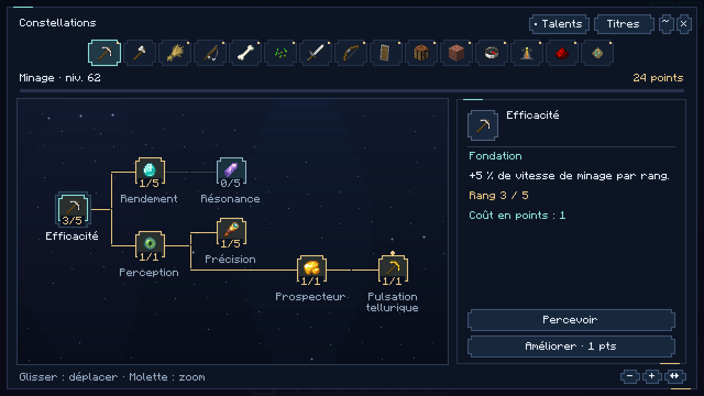
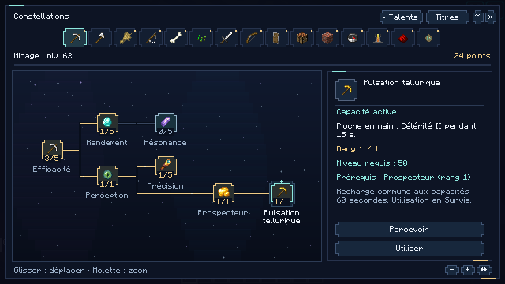
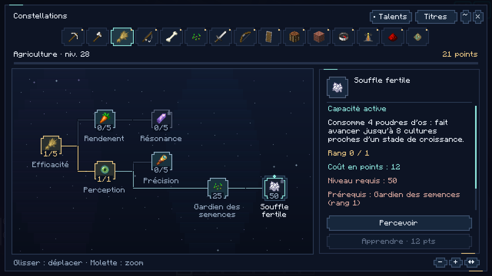
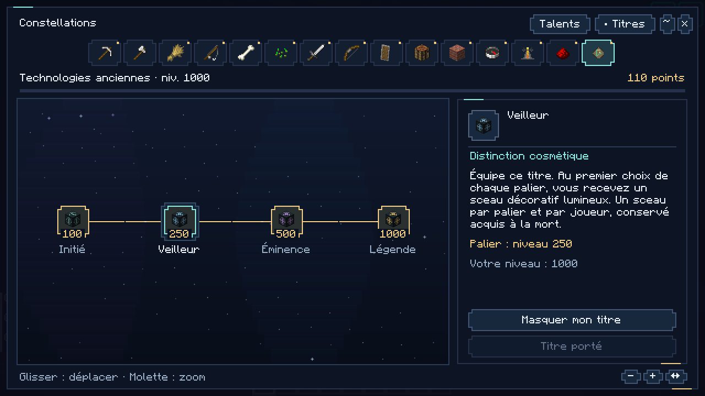
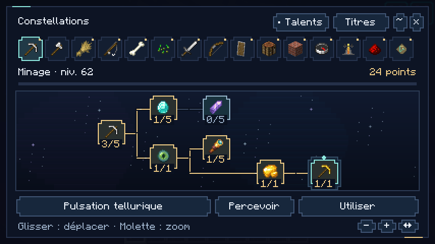

# 0.15 — Constellations

Captures F2 du client Minecraft Java 26.2 / NeoForge 26.2.0.93, sans retouche. Les niveaux et l’équipement ont été préparés dans une copie isolée d’un monde de démonstration afin de présenter les états acquis, accessibles et verrouillés. Les achats ont ensuite été effectués par les vrais boutons du menu, en Survie ; cette galerie ne représente pas une progression intégralement acquise en jouant.

## Un arbre commun aux fondations et spécialisations

Le profil de démonstration utilise le niveau 62 en minage. Les trois achats effectués pendant la vérification ont consommé 16 points et laissé 24 points disponibles.

## Une capacité active apprise

La Pulsation tellurique dispose de son bouton Utiliser ; son déclenchement a également été vérifié avec l’effet Célérité II dans l’inventaire vanilla, puis sa recharge dans le menu.

## Des conditions lisibles

Au niveau 28 en agriculture, le Souffle fertile reste verrouillé. Sa fiche montre le niveau 50 et le talent prérequis manquants. Le bouton d’apprentissage est désactivé.

## Une constellation de distinctions

Les quatre paliers restent cosmétiques. La sélection, le port et le masquage du titre ont été vérifiés, avec une seule récompense malgré deux sélections du même palier.

## Une disposition adaptée aux petites fenêtres

La vue latérale laisse place à un arbre de pleine largeur et une barre d’action distincte. Le survol donne la description complète. Capture en 854 × 480 ; la disposition a aussi été examinée en 640 × 480.

