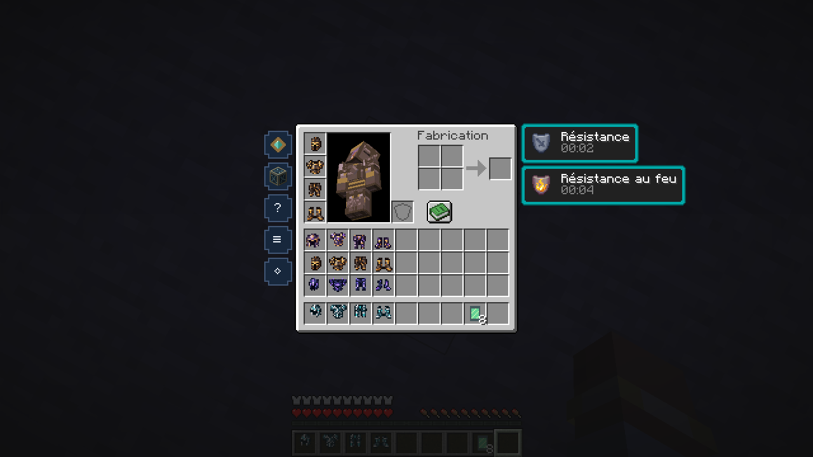
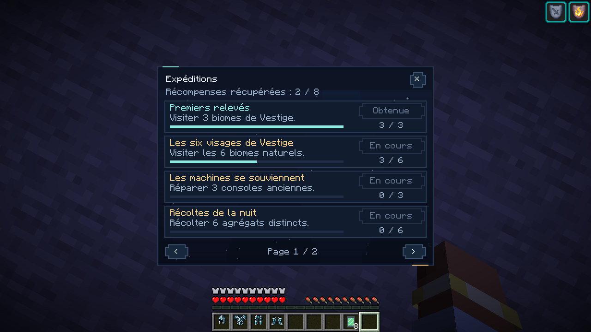
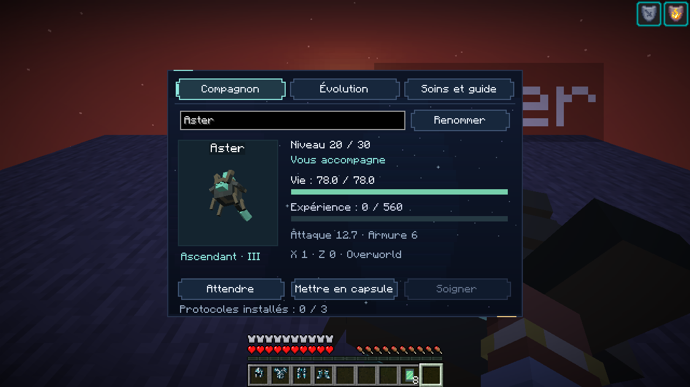
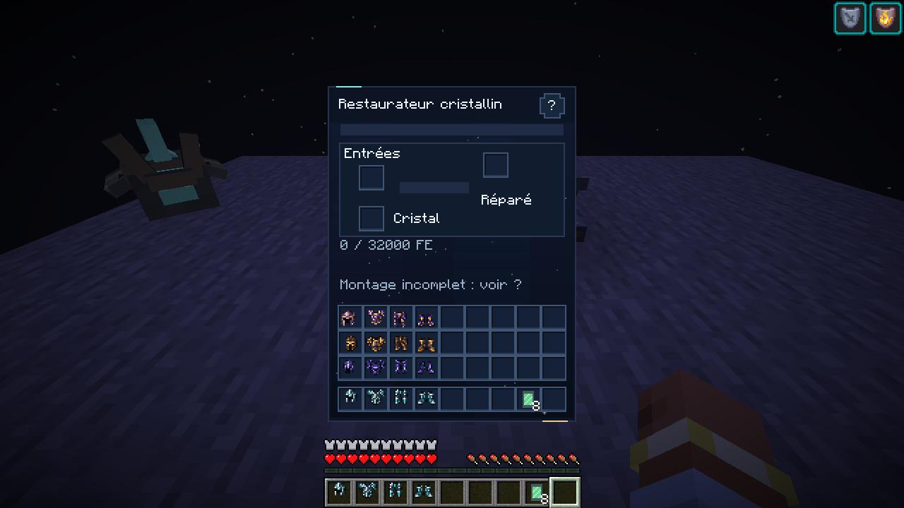
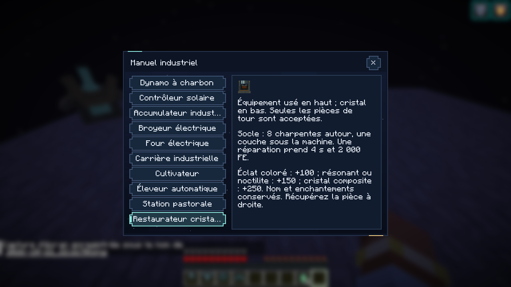
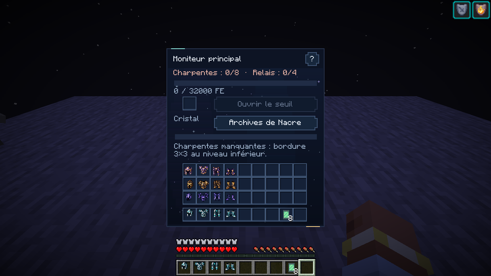
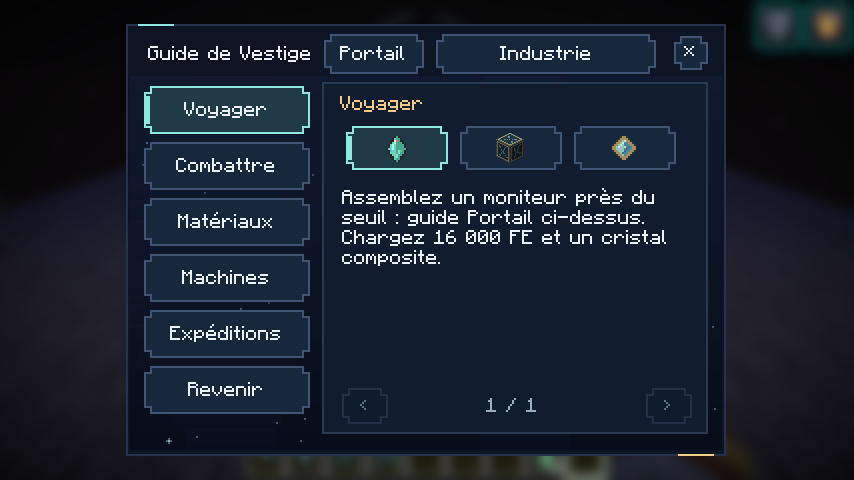
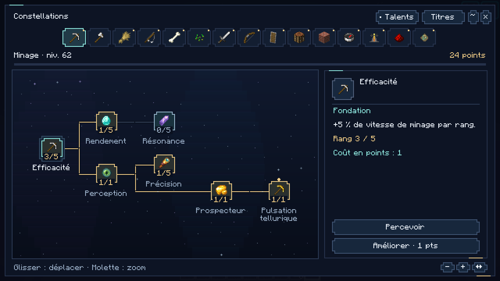

# TND 0.15.1 — Interfaces astrales

Captures F2 du client **Minecraft Java 26.2 / NeoForge 26.2.0.93**, sans retouche. Interface française, échelle GUI 2. Le monde de vérification est une copie isolée avec inventaire et progression préparés ; les écrans et interactions montrés sont ceux du mod en Survie.

## Les seize nouvelles icônes d’armure

Umbra sur la première ligne, Rempart sur la deuxième, Traque sur la troisième et Suture dans la barre rapide. Les pièces restent en **16 × 16 pixels**. Le personnage porte l’armure du Rempart : le modèle 3D et son atlas sont conservés.

## Les objectifs

Cartes opaques, texte clair, progression et commandes communes à la famille Constellations.

## Le dossier du familier

Onglet sélectionné, portrait natif, jauges de santé et d’expérience, commandes de suivi et de transport. Les pages Évolution et Soins utilisent le même thème.

## Les machines

Le restaurateur conserve ses vrais emplacements d’équipement, de cristal et de sortie. La jauge et les messages indiquent l’état réel de la machine ; le socle n’est pas assemblé dans cette présentation.

Le manuel affiche les conditions de construction et les recettes, avec navigation sélectionnée et libellés complets au survol.

## Le moniteur du portail

Énergie, montage, cristal et état du seuil restent regroupés dans une interface compacte. Le bouton d’ouverture est indisponible tant que les conditions ne sont pas remplies.

## Le guide dans une petite fenêtre

Fenêtre de **854 × 480**, sans redimensionnement de la capture : navigation, icônes, fiche et fermeture restent accessibles.

## L’arbre de compétences reste la référence

Les contrôles communs reprennent ses couleurs et ses contours. Les branches, icônes, prérequis, rangs et points de l’arbre sont conservés.

Les archives et les terminaux narratifs ont également été examinés dans le client ; leurs textes ne sont pas reproduits ici pour préserver la découverte. Les contrôles couvrent l’ouverture des treize écrans, la pagination, les onglets du familier, les trois pages du guide du portail, le changement de mode d’extraction et le déploiement du familier depuis sa capsule. Il ne s’agit pas d’une campagne Survie intégralement parcourue. Le client cloud utilise un rendu logiciel et une sortie audio virtuelle ; aucune mesure générale de FPS ni écoute physique n’est revendiquée.

[Présentation de la version](docs/ASTRAL_0.15.1.md) · [Télécharger le JAR](https://github.com/axephir/TheNewDimension/raw/refs/heads/downloads/tnd-0.15.1-dev.jar)
