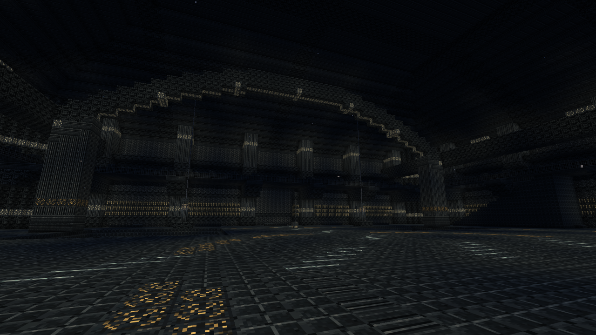
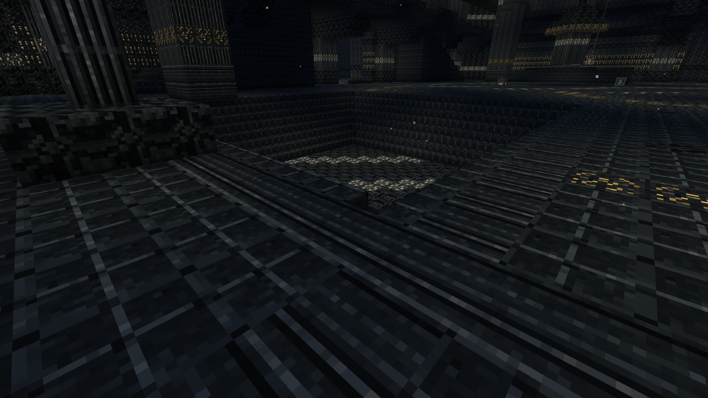
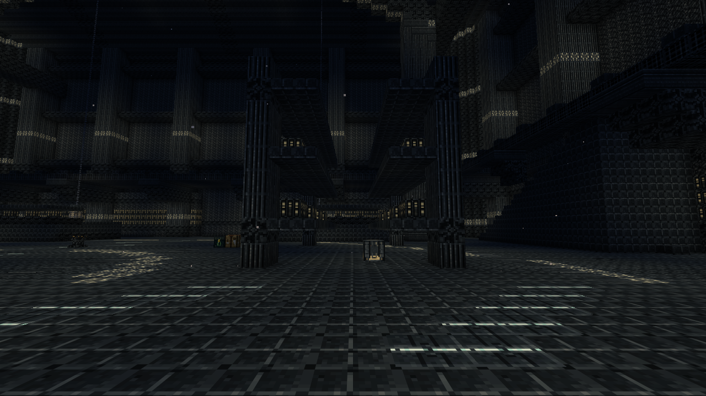
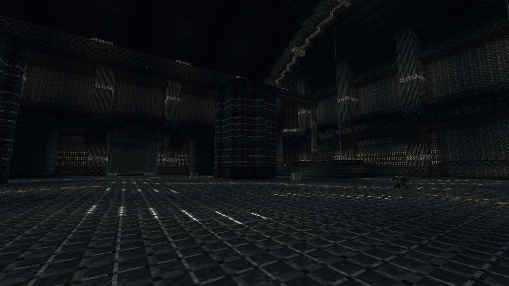
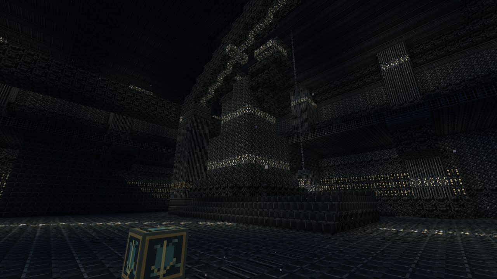
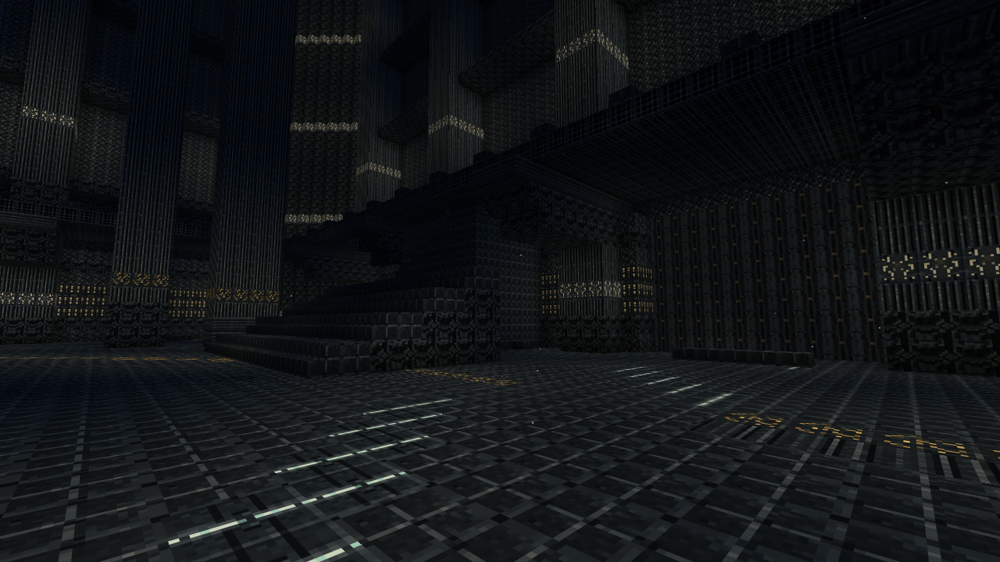
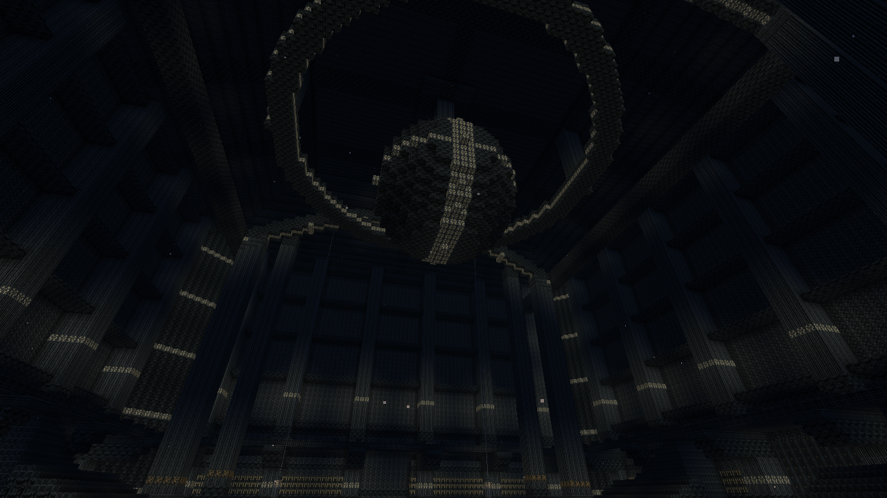
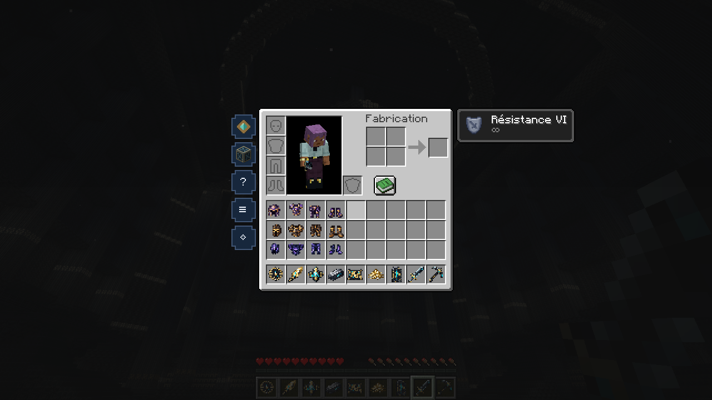

# Reliefs du Premier Silence — 0.16.1

Captures **F2 sans retouche**, dans Minecraft Java 26.2 / NeoForge 26.2.0.93. Nouveau site généré naturellement dans le monde de contrôle isolé. Positions et inventaire préparés, vues en modes créatif et survie. Personnage de contrôle avec Résistance VI. Les captures montrent la révision architecturale ; elles ne mesurent pas la durée d’une campagne ni l’équilibrage final.

Les 48 chambres disposent des nouvelles sections : fondations excavées, cours à quatre niveaux, arcades, alcôves, terrasses et gradins. Les objectifs restent à leurs emplacements d’origine. Les neuf nouveaux sprites s’appliquent également aux objets déjà possédés. Les constructions sauvegardées ne sont pas réécrites : explorer un autre site dans de nouveaux chunks.

[Source validée](https://github.com/axephir/TheNewDimension/commit/09d156d83d47b596177b982e1f907ae94a33458c) · [CI du commit exact](https://github.com/axephir/TheNewDimension/actions/runs/39940222548) · [Guide](docs/INTERIORS_0.16.1.md) · [Validation](VALIDATION-0.16.1.txt)

## Arcades, terrasses et alcôves

## Cours encaissées et marches minérales

## Archives : rayonnages ajourés et réserves

## Fonderie : réacteurs et conduites

## Jardins : arbres pétrifiés et reliefs

## Arène : tribunes en gradins et volume de combat

## Voûtes et oculus du dernier acte

## Les neuf sprites en 16 × 16 dans l’inventaire

