# Premier Silence — galerie Minecraft 0.16

Captures **F2 sans retouche**, dans Minecraft Java 26.2 / NeoForge 26.2.0.93. Monde de contrôle isolé, inventaire et progression préparés. Le personnage de contrôle utilise Résistance VI ; certaines défaites sont provoquées par commandes pour vérifier les couches et récompenses. Ces images ne constituent pas une campagne gagnée sans aide ni une mesure de durée.

Les architectures sont générées naturellement. Les machines utilisent des stocks et réserves FE explicitement préparés, puis produisent réellement. Les vues des bâtiments et combats proviennent de la vérification des candidats 0.16 ; l’inventaire, le manuel industriel et le guide compact montrent les neuf sprites finaux. Aucun visuel des références Assassin’s Creed n’est incorporé.

[Source validée](https://github.com/axephir/TheNewDimension/commit/395cba714929ce5bc42ffa7b02f5358cda2e6302) · [CI du commit exact](https://github.com/axephir/TheNewDimension/actions/runs/39903419491) · [Guide de la version](docs/PREMIER_SILENCE_0.16.md) · [Rapport de validation](VALIDATION-0.16.txt)

## Entrée monumentale et couronne de pics

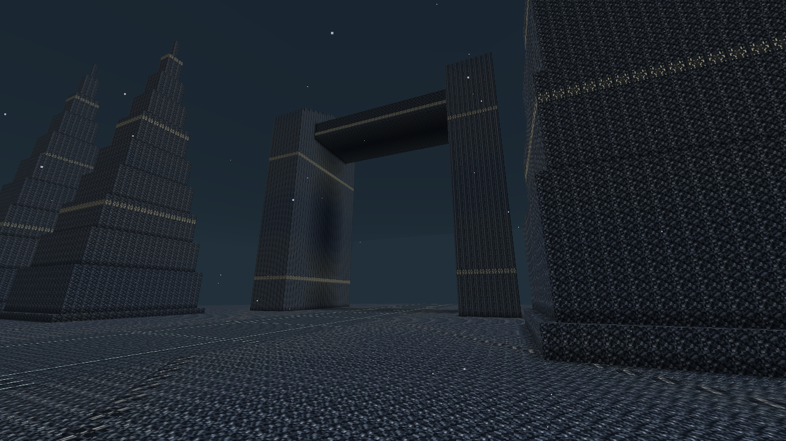

## Archives enfouies et galeries soutenues

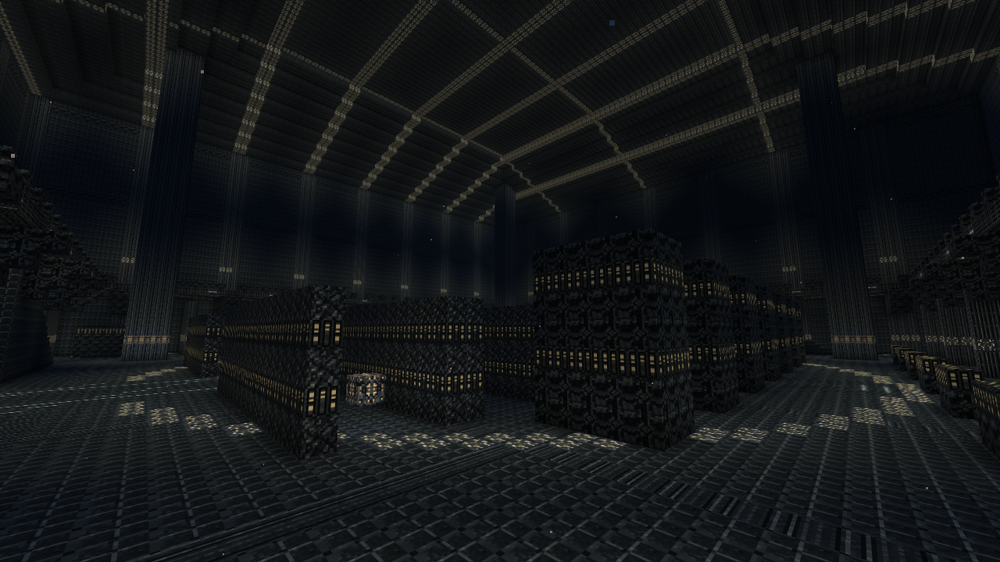

## Forges du Silence

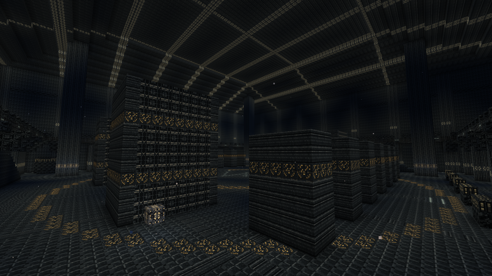

## Jardins pétrifiés

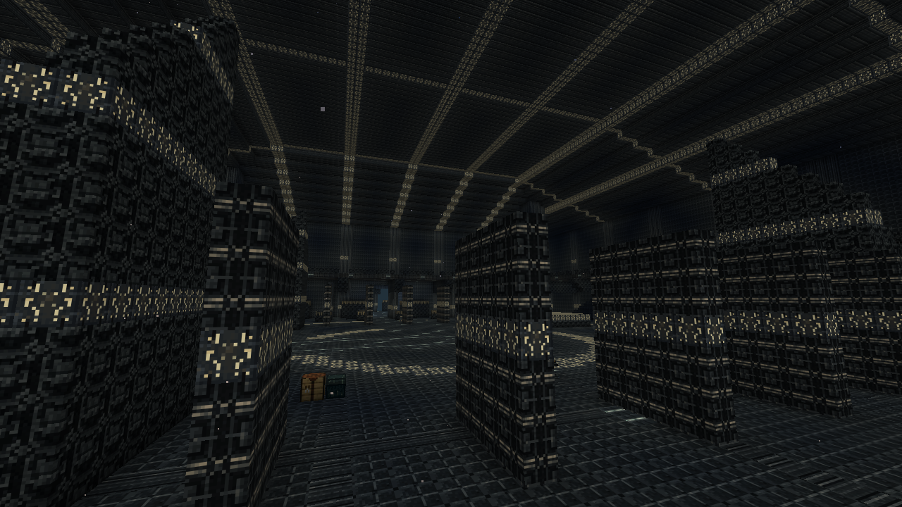

## Flèche centrale au-dessus des voûtes

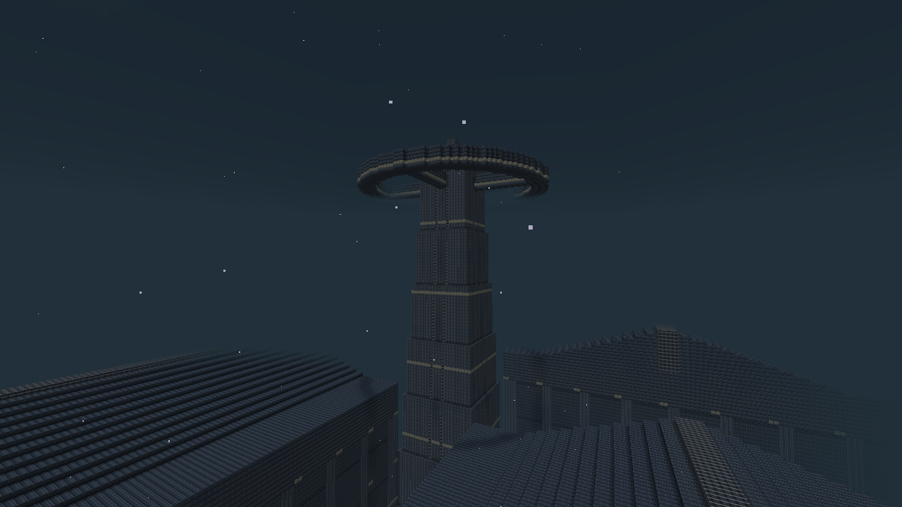

## Grand oculus suspendu dans la salle finale

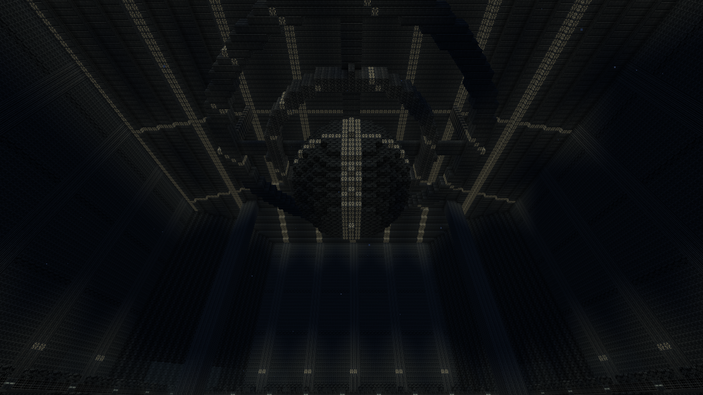

## Axiome et Antiphone : deux gardiens actifs

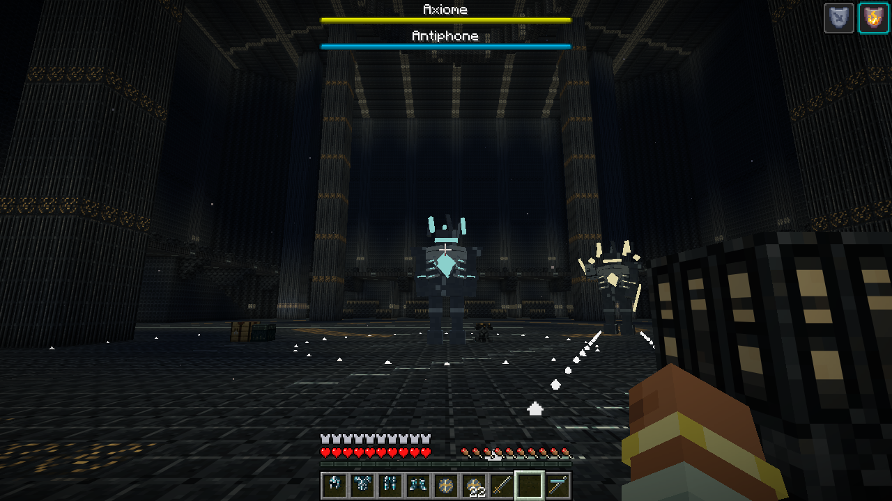

## Archonte du Premier Silence et marques au sol

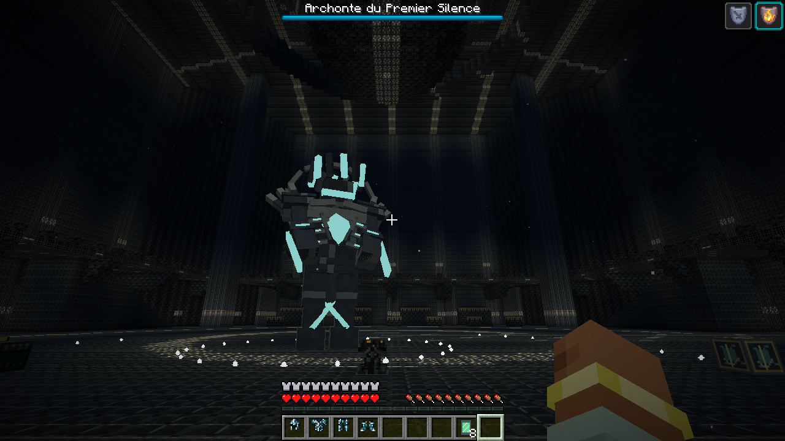

## Carte des 48 chambres — progression préparée

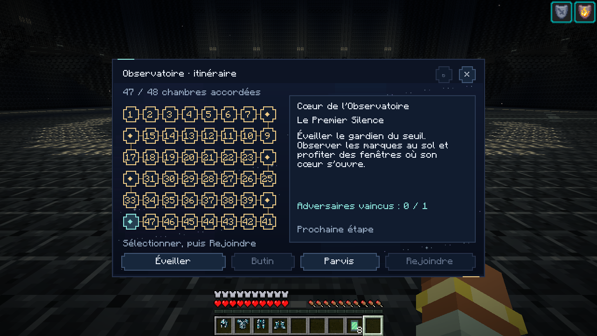

## Accord demandé et positions réelles des disques

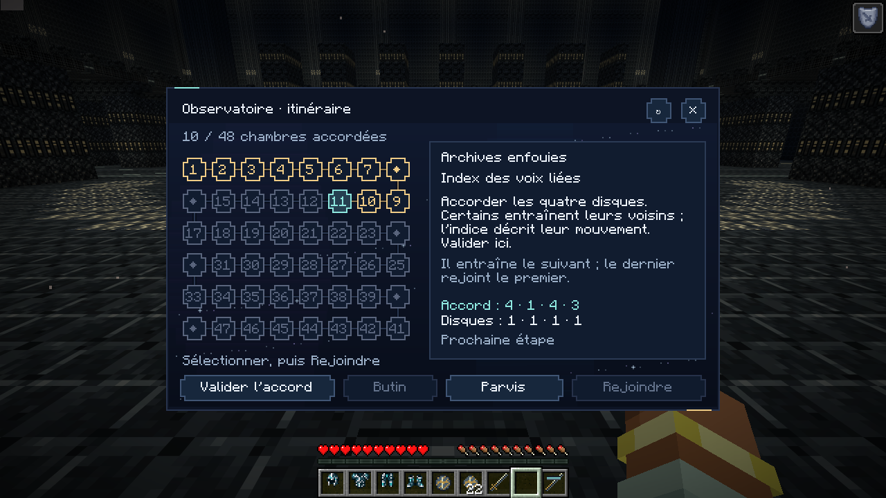

## Les neuf icônes finales en 16 × 16

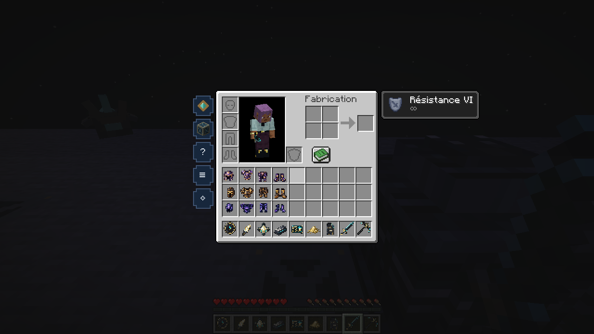

## Raffinerie : 48 produits après seize cycles et épuisement de la réserve FE

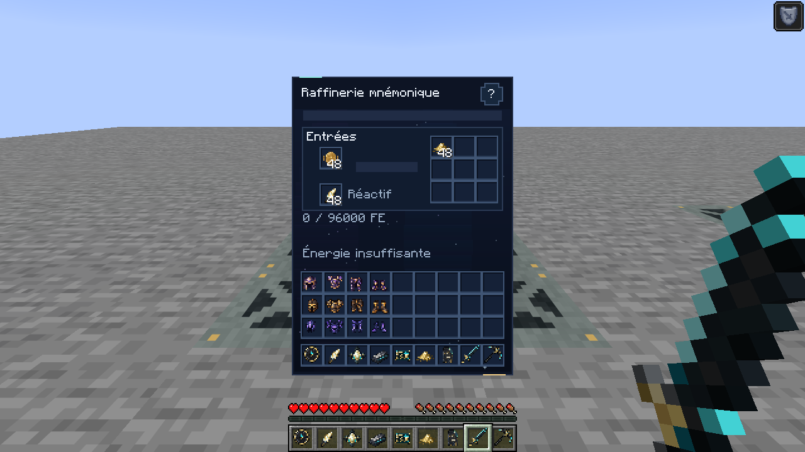

## Manuel industriel : page 2 et fonctionnement du trieur

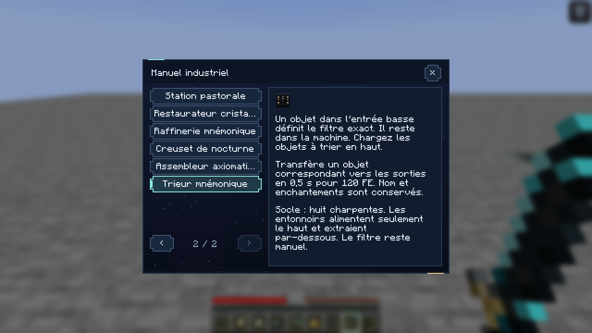

## Guide de l’Observatoire en fenêtre native 854 × 480

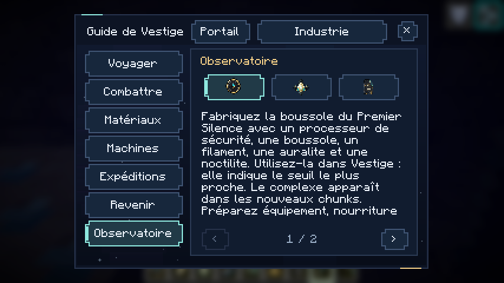

