# L’Éveil des Témoins — 0.17

Captures **F2 sans retouche**, dans Minecraft Java 26.2 / NeoForge 26.2.0.93. Monde de contrôle isolé, site inédit, personnage de survie préparé avec Résistance VI. Téléportations entre les dispositifs ; les gardes sont vaincus par commandes et l’intégrité du Colosse est abaissée par commandes pour observer ses phases. Ces vues ne représentent pas une campagne gagnée sans aide ni une mesure de durée.

Les trois stèles, prismes, relais, coupleurs et réceptacles sont manipulés dans le client. La passerelle est réellement construite puis traversée à pied. Les découvertes sont personnelles et conservées après sauvegarde. Cette version concentre les nouveaux mécanismes sur les huit salles du premier acte ; les autres actes gardent leurs objectifs existants.

[Source validée](https://github.com/axephir/TheNewDimension/commit/c6bb70ce06521b1adeac34c8a782ca6015071b3a) · [CI du commit exact](https://github.com/axephir/TheNewDimension/actions/runs/39956124775) · [Guide](docs/WITNESSES_0.17.md) · [Validation](VALIDATION-0.17.txt)

## Le parvis et ses gravures réveillées

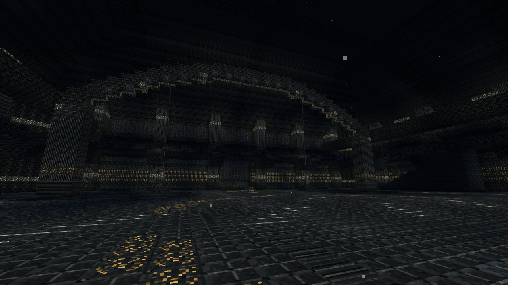

## Premier réceptacle : couvercle guidé et aide contextuelle

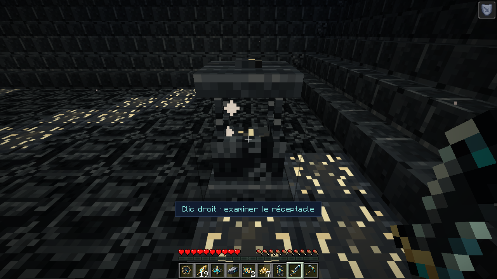

## Un seuil monumental se lève

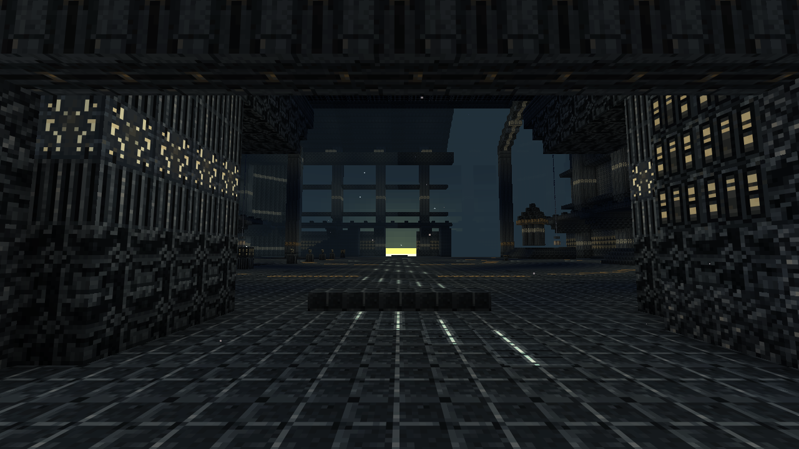

## Les prismes et leur faisceau après l’accord réel

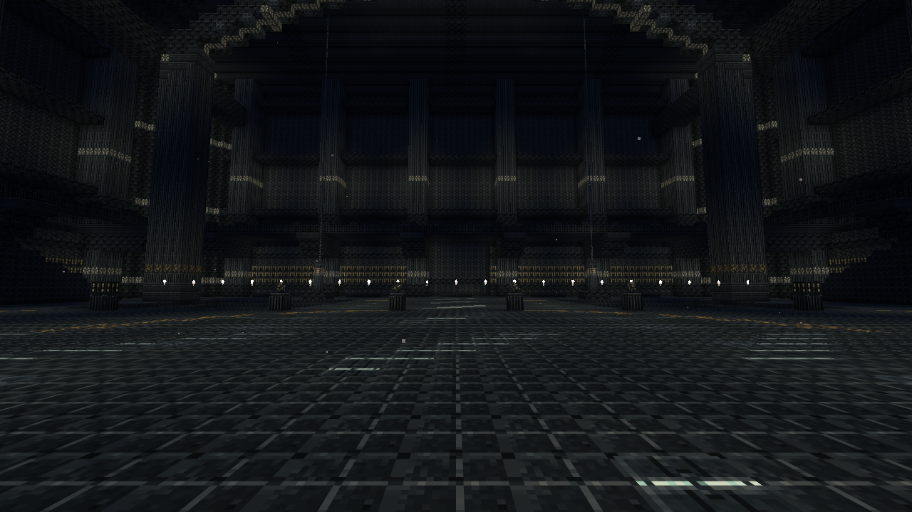

## L’alcôve libérée par les relais

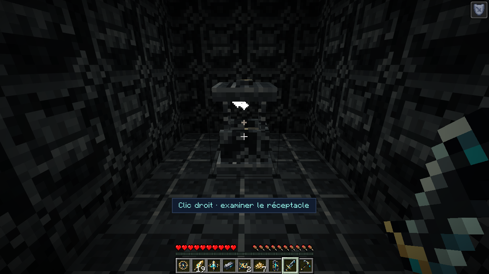

## La passerelle pendant son déploiement

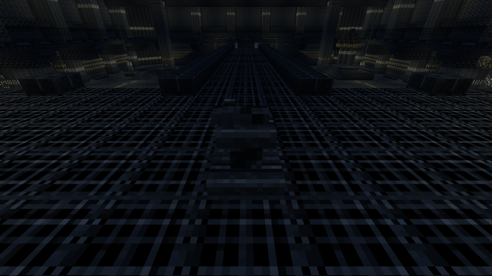

## Le passage après sa traversée à pied

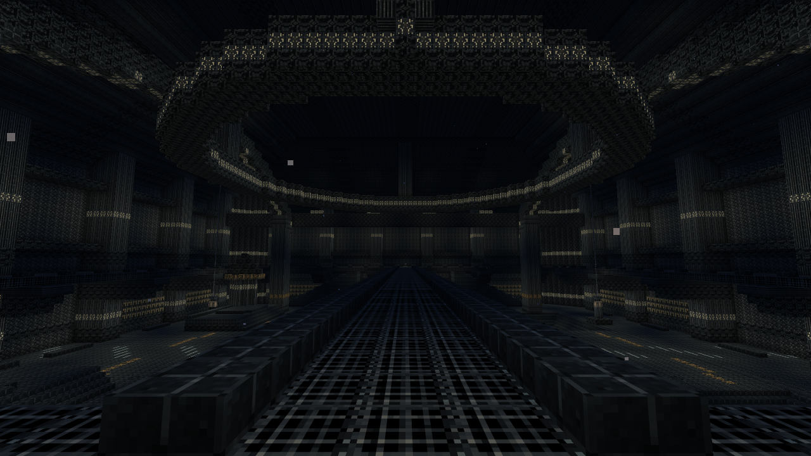

## Le circuit restauré dans la salle des échos

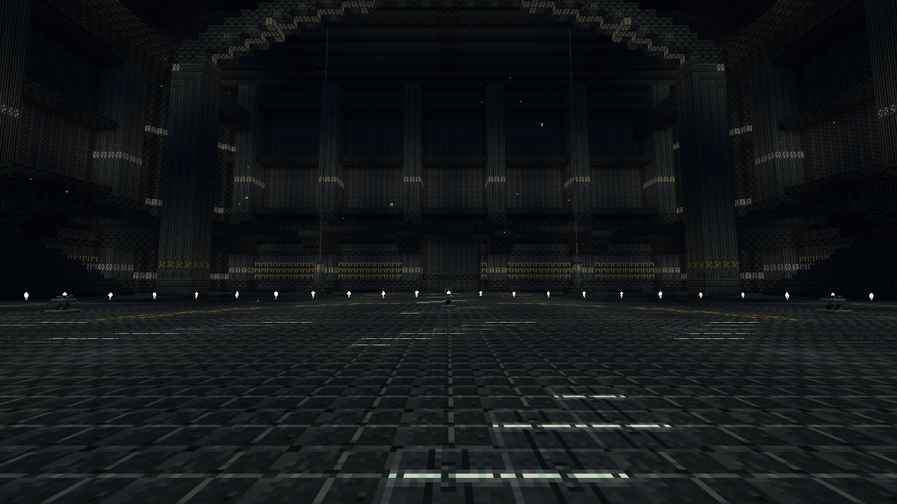

## Aide au viseur et réponse du courant sans superposition

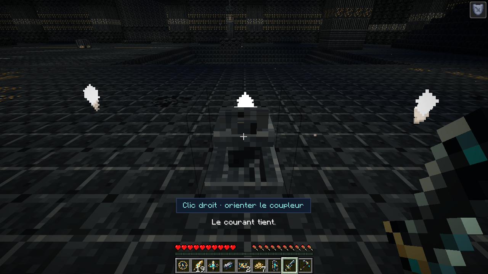

## Carte, circuit, échos et découvertes personnelles

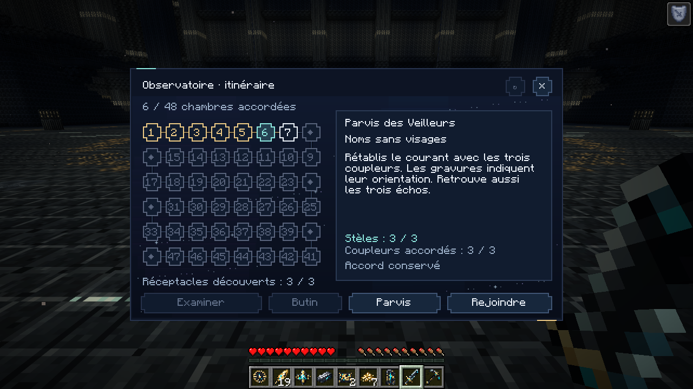

## Interface en fenêtre native 854 × 480

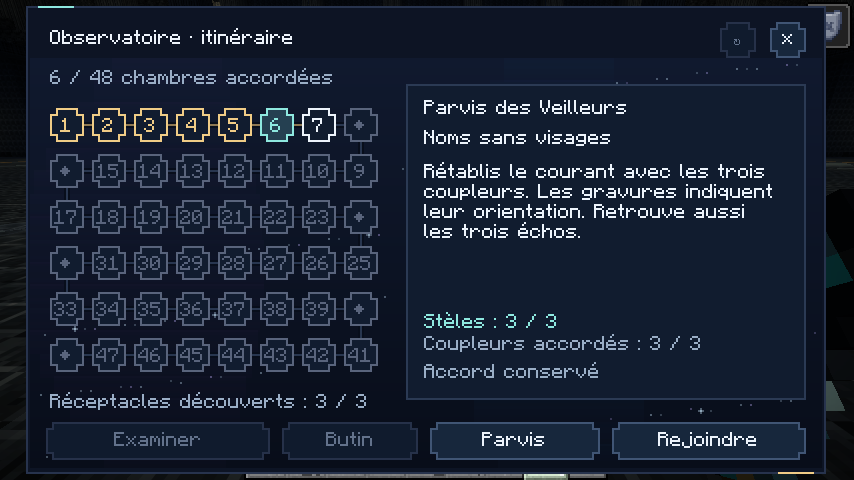

## L’émergence du Colosse du Seuil

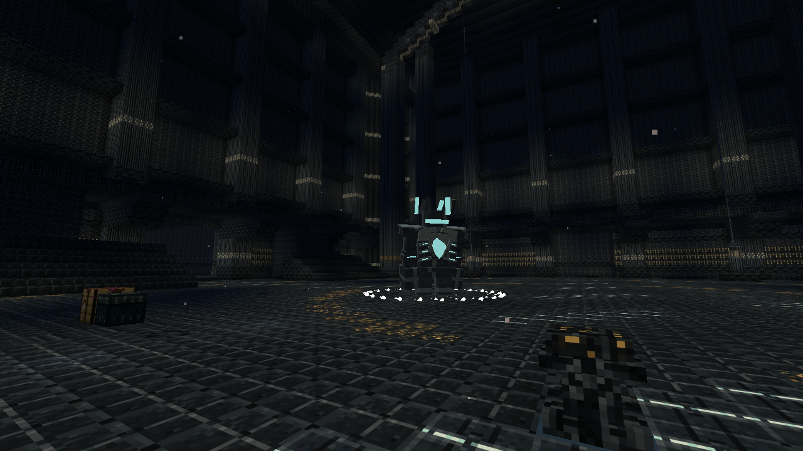

## Le Colosse du Seuil pendant le combat

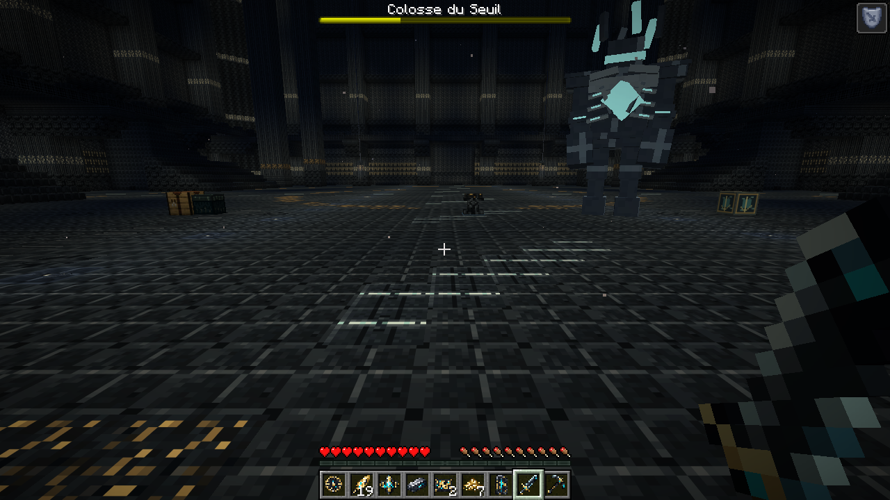

