# La Forge du Premier Feu — 0.18

Quatorze captures **F2 natives, sans retouche**, dans Minecraft Java 26.2 / NeoForge 26.2.0.93. Le monde de contrôle est isolé, le personnage préparé en Survie avec Résistance VI. Le premier acte est crédité pour accéder directement à ce nouvel acte. Téléportations entre les dispositifs et commandes pour accélérer les combats et installer l’atelier ; ces images ne constituent pas une campagne gagnée sans aide ni une mesure de durée.

Les stèles, vannes, disques couplés, relais, échos et purges sont manipulés dans le client. Les deux niveaux d’escaliers et une échelle de secours sont parcourus sans vol. La traversée supérieure est construite puis franchie à pied. La trempe est confirmée dans sa vraie interface, avec de vrais objets, un transfert FE par câbles et un attribut d’équipement vérifié. Les tests automatisés contrôlent séparément la conservation des enchantements, l’usure, les entonnoirs, les récompenses personnelles et les sauvegardes.

Cette version transforme les huit chambres du deuxième acte. Le premier acte de la 0.17 reste inclus ; les quatre suivants conservent leurs objectifs existants. Explorer un Observatoire entièrement inédit pour la nouvelle géométrie et ses mécanismes.

[Source validée](https://github.com/axephir/TheNewDimension/commit/69beabf832f93656ee15da4a7c2062420451166e) · [CI du commit exact](https://github.com/axephir/TheNewDimension/actions/runs/40001029104) · [Guide](docs/FOUNDRY_0.18.md) · [Validation](VALIDATION-0.18.txt)

## Le vestibule et ses grandes turbines

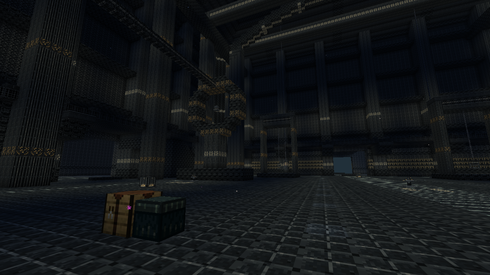

## Une vanne, sa graduation et son aide au viseur

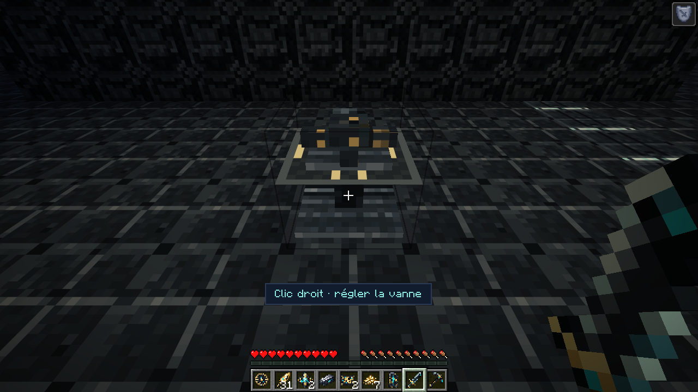

## Les gardes dans la halle des marteaux

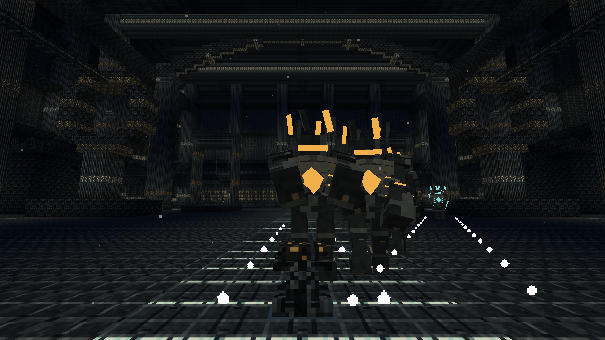

## Distribution prismatique et structures porteuses

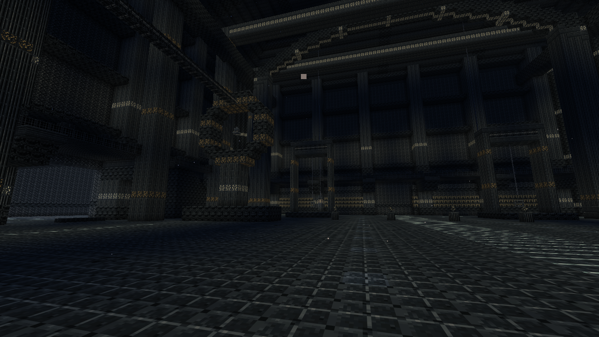

## Le Puits du Premier Feu

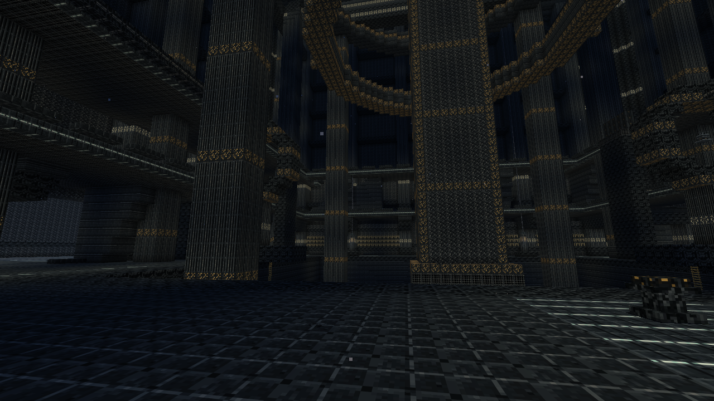

## Les galeries hautes au-dessus de la cuve

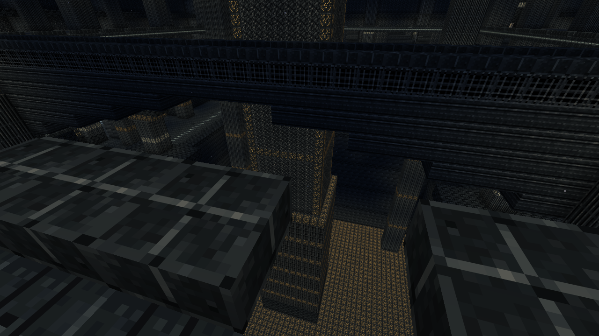

## La traversée supérieure après sa remise en marche

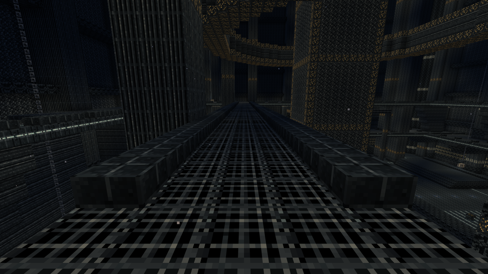

## Résonances, vannes et passage supérieur sur la carte

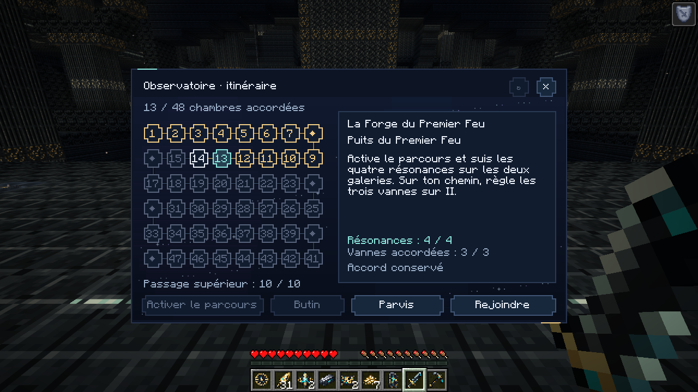

## Le Premier Fondeur et le Régulateur

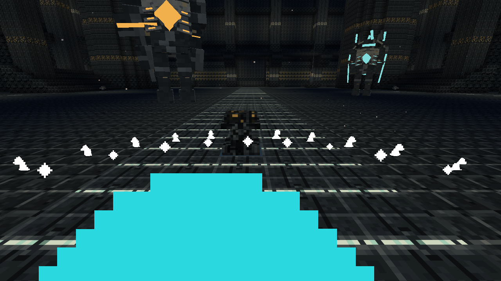

## Une purge ouvre les cœurs du duo

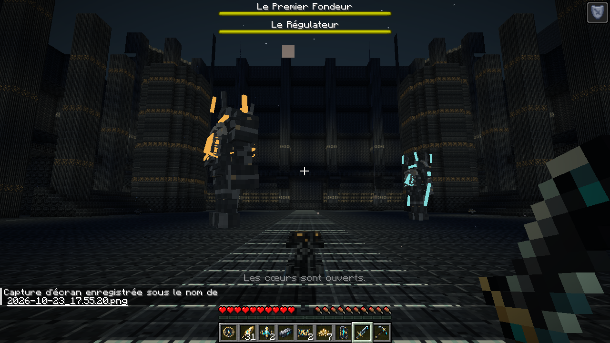

## La forge de trempe et son installation FE

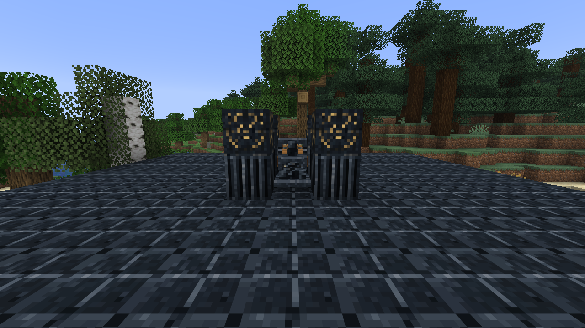

## Choix exclusif, aperçu et coût de la trempe

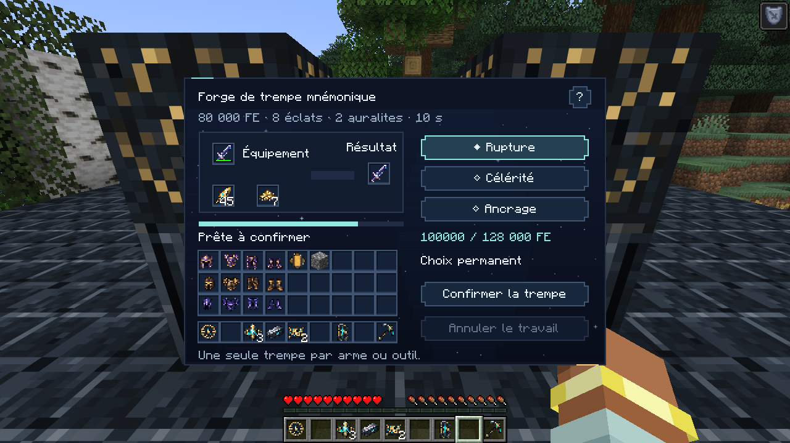

## Le résultat et son véritable attribut natif

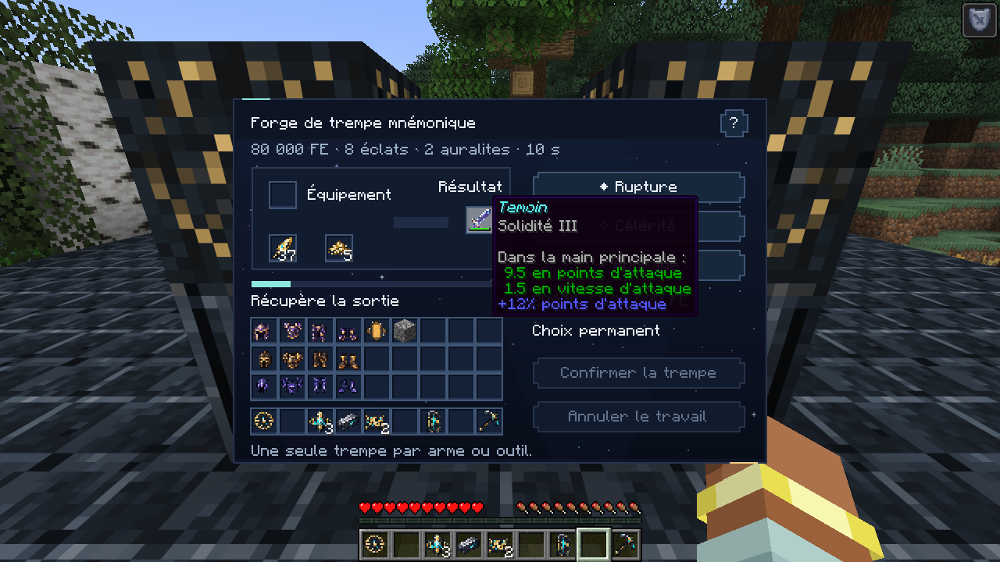

## La même interface en fenêtre native 854 × 480

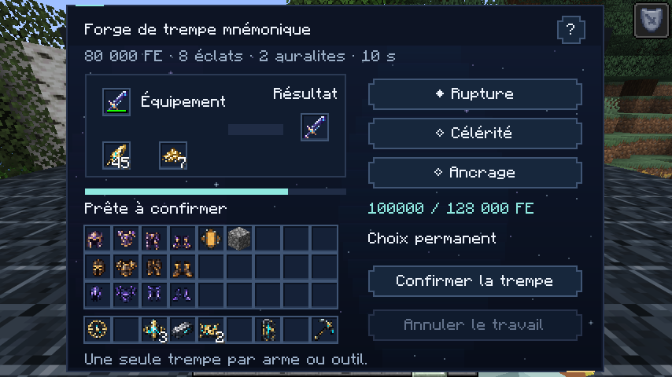

