# Les Archives du Silence — 0.19

Seize captures **F2 natives, sans retouche ni redimensionnement**, dans Minecraft Java 26.2 / NeoForge 26.2.0.93. Le monde de contrôle est une copie isolée ; personnage en Survie avec Résistance VI. Les seize premières stations sont créditées uniquement pour accéder au troisième acte dans un Observatoire entièrement inédit.

Les huit nouvelles chambres sont ensuite opérées dans le vrai client : stèles, miroirs, confirmation, quatre relais, ancre manuelle, quatre résonances, ordre des souvenirs, rencontres finies, éveil du gardien et ouverture du noyau. Les deux escaliers et la passerelle sont parcourus **sans vol ni saut**. Téléportations entre les interactions, commandes pour accélérer les morts des ennemis et du boss et lentille de contrôle pour examiner les reliques : ces images ne constituent pas une campagne gagnée sans aide, une mesure de durée ni un équilibrage final.

L’Atlas conserve quatre résonances et son passage complètement reconstruit ; le registre natif conserve les 24 premières chambres. Le menu des reliques est réellement déverrouillé, l’Égide choisie et invoquée par R. La sauvegarde conserve l’accord. Le client utilise llvmpipe et une sortie audio de contrôle ; aucune performance sur matériel de joueur ni écoute physique n’est revendiquée. Les tests contrôlent séparément le familier, les esquives obstruées, les sauvegardes et l’unicité des récompenses.

[Source validée](https://github.com/axephir/TheNewDimension/commit/9db7167eeaaf931b580655e558dc44eeafc8b6be) · [CI du commit exact](https://github.com/axephir/TheNewDimension/actions/runs/40026678521) · [Guide](docs/ARCHIVES_0.19.md) · [Validation](VALIDATION-0.19.txt)

## Monolithes gravés et galerie du Portique

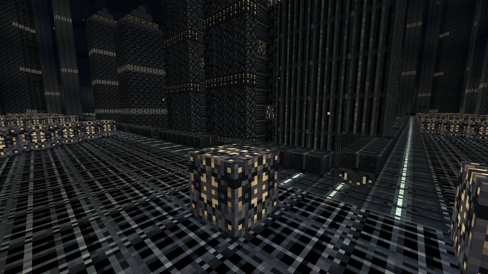

## Un miroir accordé et son aide au viseur

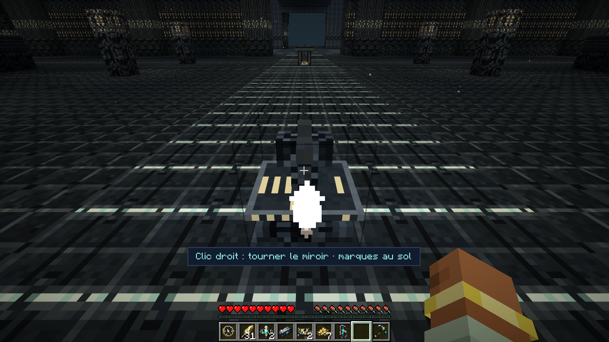

## Veilleurs et effaceurs dans leur vraie rencontre

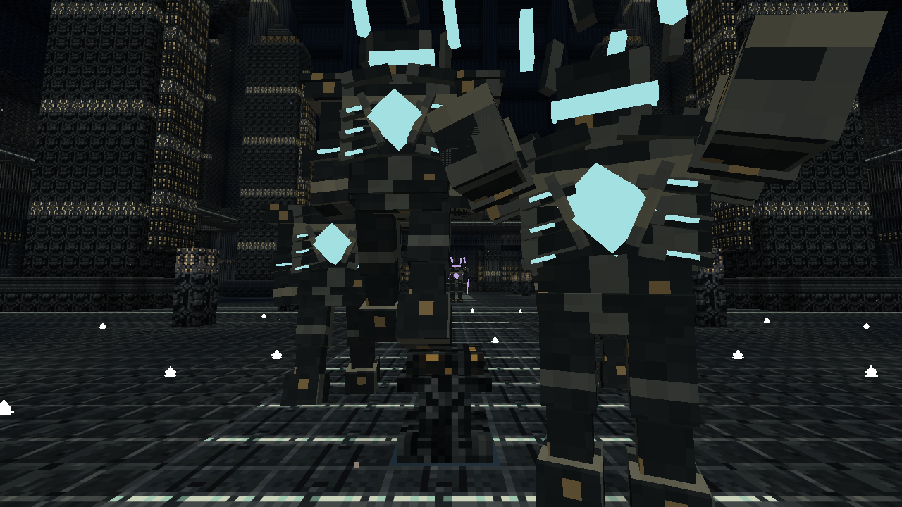

## Les trois accords dans la Salle des Réfractions

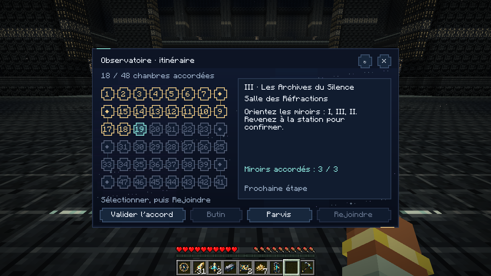

## L’Atlas suspendu et son socle monumental

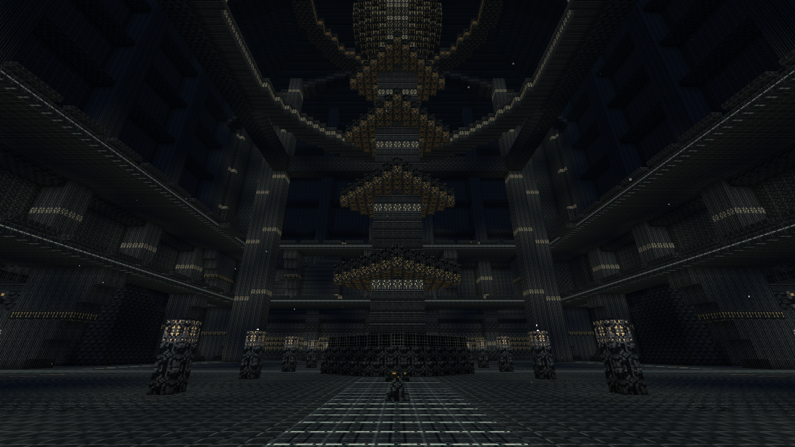

## Les deux niveaux sous le grand instrument

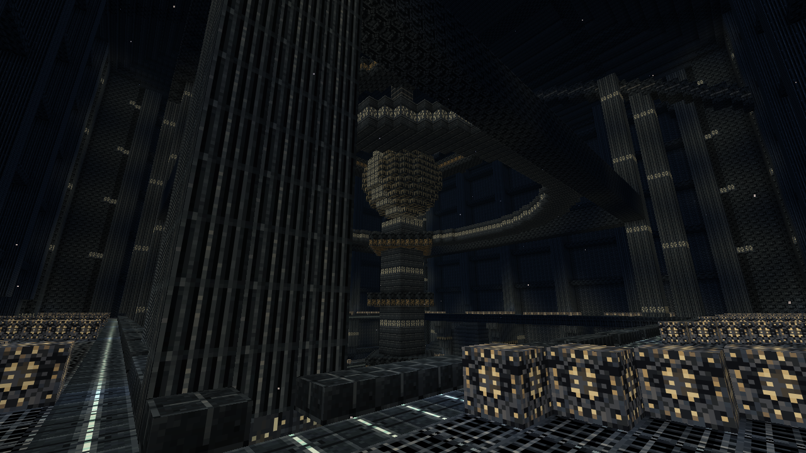

## Le passage supérieur restauré

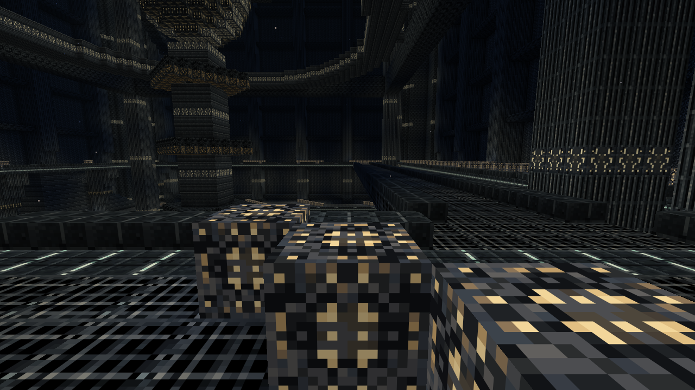

## Quatre résonances et dix étapes de reconstruction

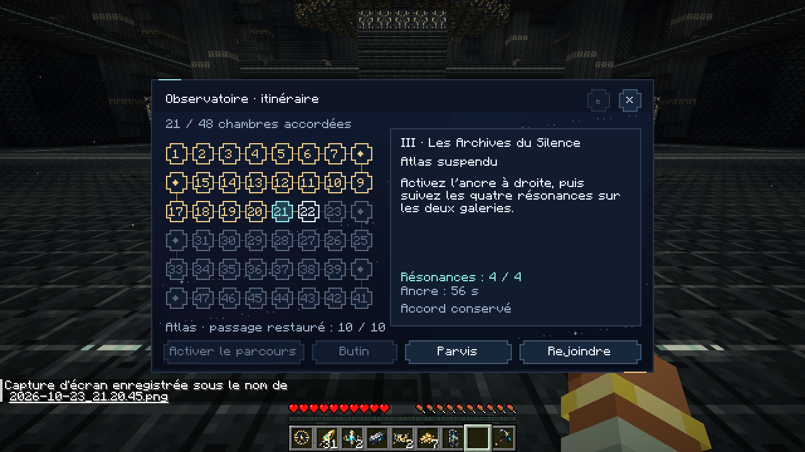

## Une stèle du Palimpseste

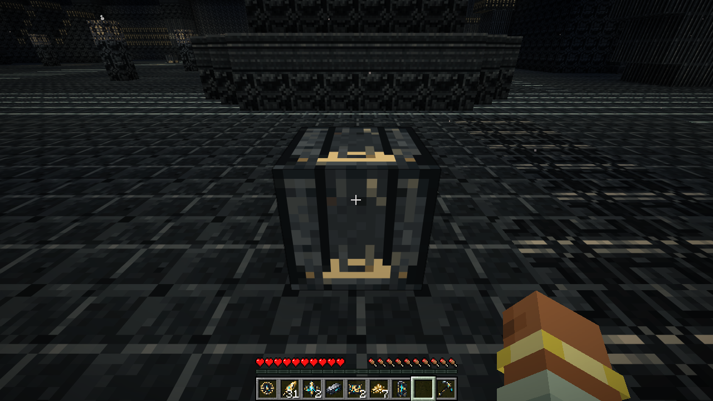

## Le Conservateur et sa cage articulée

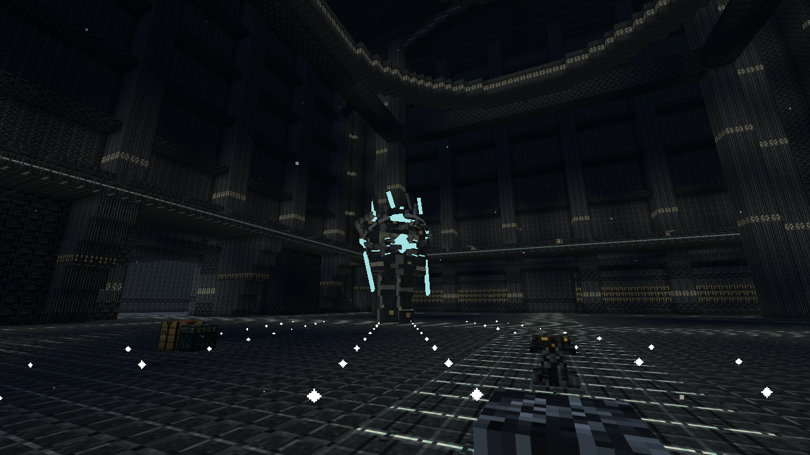

## Une ancre expose le noyau du gardien

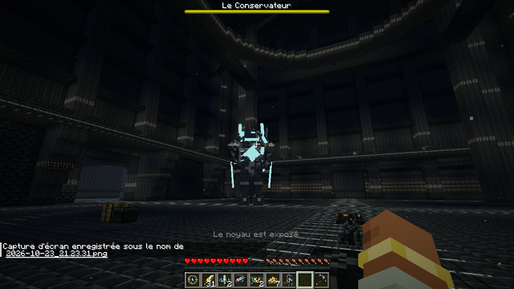

## Les huit nouvelles chambres achevées

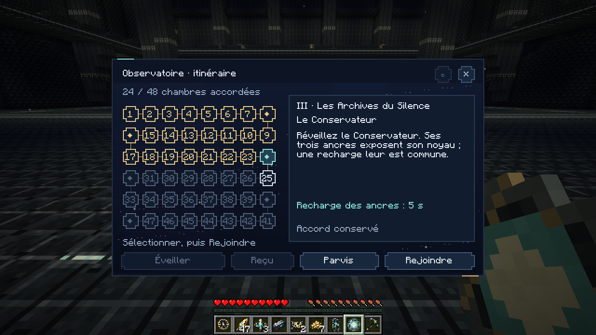

## Trois choix autour d’un seul accord actif

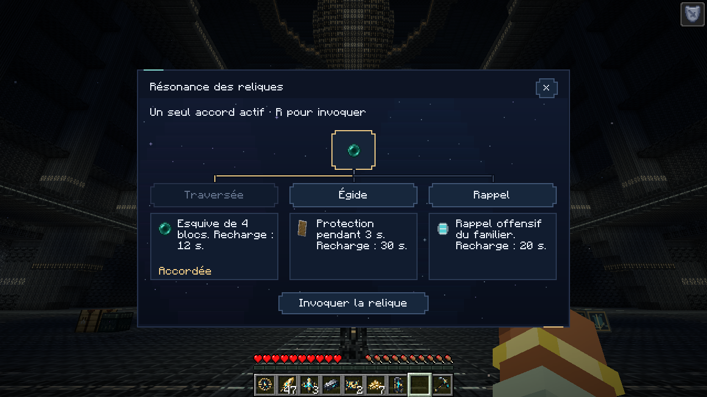

## L’Égide sélectionnée dans le menu astral

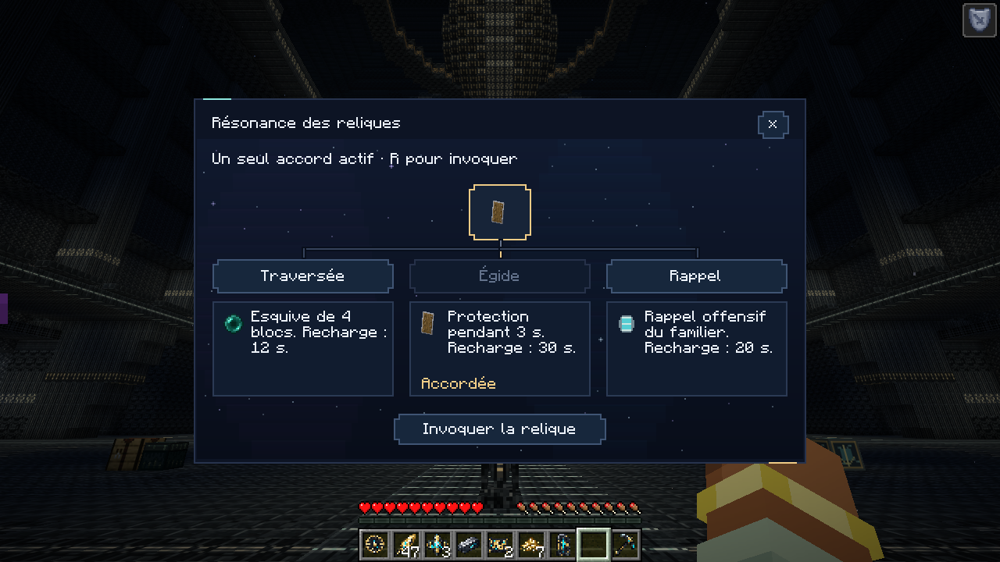

## Invocation native et recharge commune

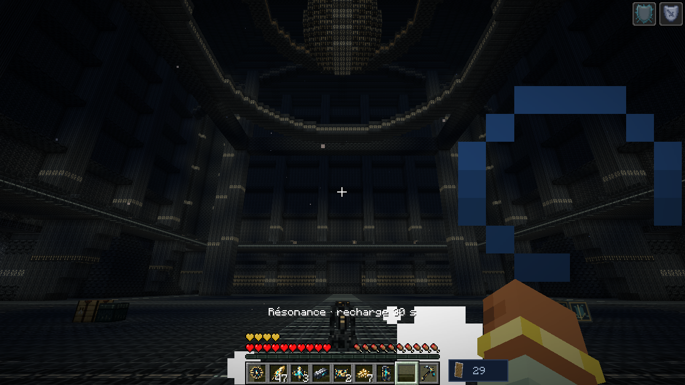

## Le menu en fenêtre native 854 × 480

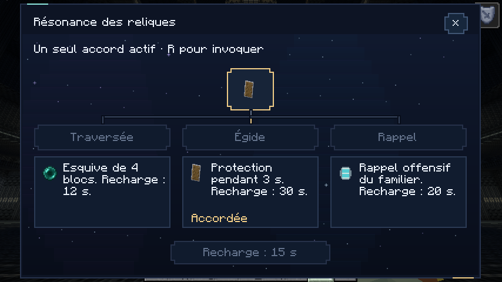

