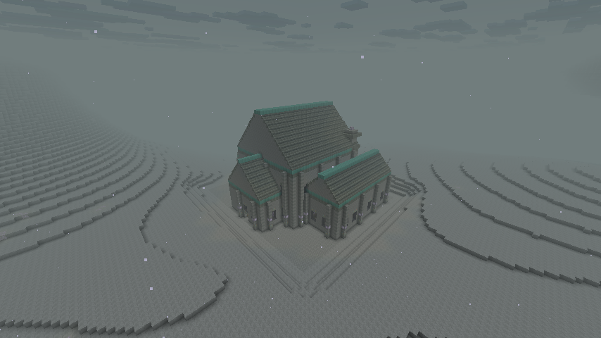
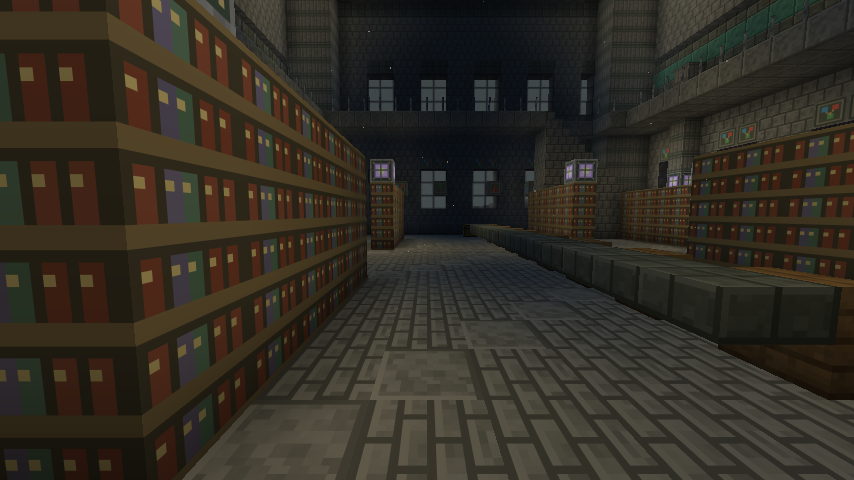
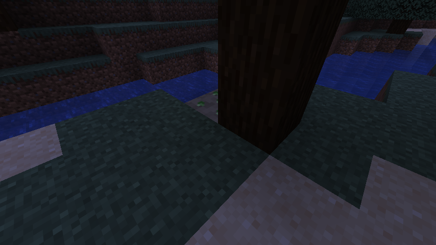
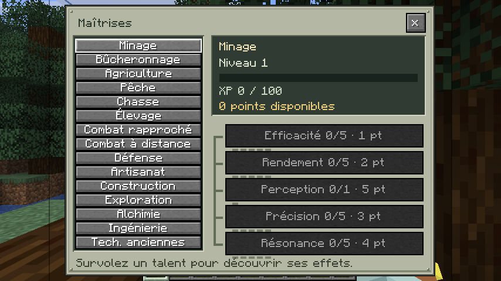
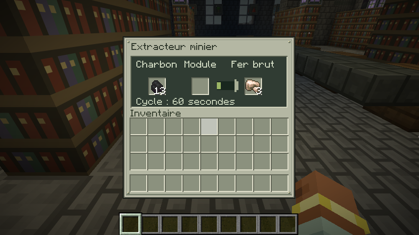

# Captures de la version 0.2.0

Captures originales du client Minecraft Java 26.2 avec NeoForge 26.2.0.93, sans pack de textures supplémentaire. Les vues de l’archive et du minerai sylvestre proviennent d’un monde généré pour la validation. L’extracteur a été placé dans ce monde pour contrôler son interface.

## Archive de Vestige

## Minerai sylvestre visible à la racine d’un arbre

## Maîtrises accessibles depuis l’inventaire

## Extracteur

