# Les Soutes de Nacre — 0.20

Dix-huit captures **F2 natives, sans retouche ni redimensionnement**, dans Minecraft Java 26.2 / NeoForge 26.2.0.93.

Les deux premiers secteurs sont réellement engagés : quatre vagues de douze gardes, puis vingt-quatre gardes et le Bastion. Les morts sont accélérées par commandes dans un personnage de contrôle en Survie avec Résistance VI. L’interaction avec son nodule remet réellement trois bruts d’astérium et un moteur disjoint ; la sauvegarde conserve les deux secteurs et la récompense personnelle réclamée.

La galerie est montée de Y 17 à Y 23 **sans vol ni saut**, avec le saut automatique désactivé. L’échelle est remontée depuis Y 17 jusqu’à la rue, Y 89. La Lentille et la salle du Souverain sont photographiées en Spectateur pour examiner leur architecture ; ces images ne créditent pas les six secteurs restants.

L’atelier est une scène de contrôle : blocs, composants, énergie et équipements fournis par commandes. Les sept contrôleurs sont exposés devant leurs montages ; la centrifugeuse travaille vraiment. Les interfaces et les pages de construction sont vérifiées en grandes et petites fenêtres. L’armure est réellement équipée. Rendu llvmpipe et sortie audio de contrôle : aucune performance sur matériel de joueur, écoute physique, durée de campagne ou victoire complète sans aide n’est revendiquée.

[Source validée](https://github.com/axephir/TheNewDimension/commit/65f9d94227ceebc39f0c70570d1ce2a776da4c49) · [CI du commit exact](https://github.com/axephir/TheNewDimension/actions/runs/40047494785) · [Guide de jeu](docs/DEPTHS_0.20.md) · [Validation](VALIDATION-0.20.txt) · [Télécharger le JAR](tnd-0.20.0-dev.jar)

## L’unique pavillon d’accès, sur la rue de Nacre

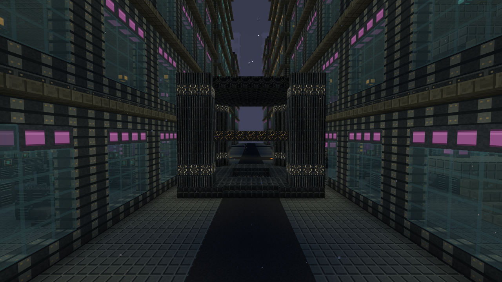

## Le même accès rejoint les Soutes par une échelle continue

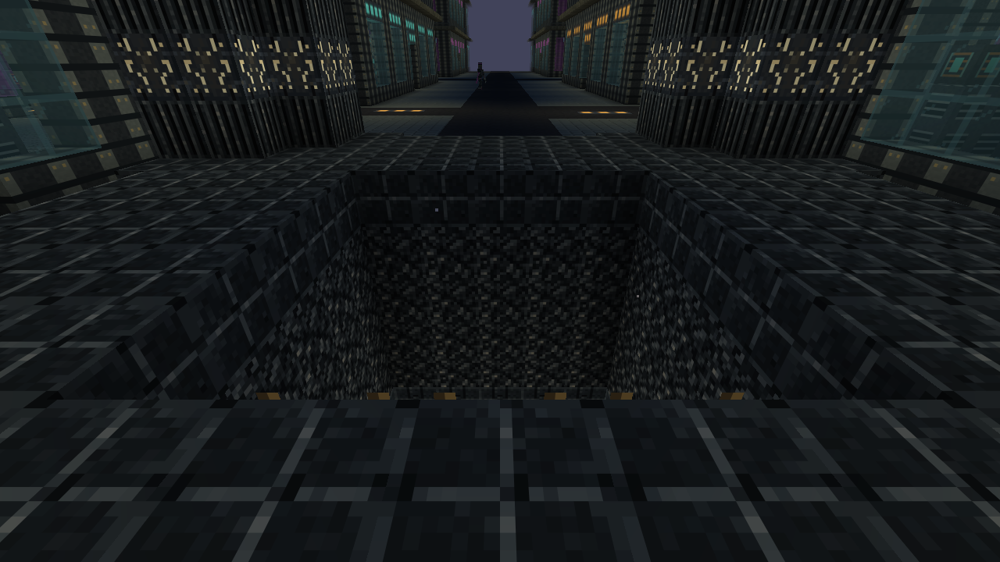

## Le débarcadère et sa grue suspendue

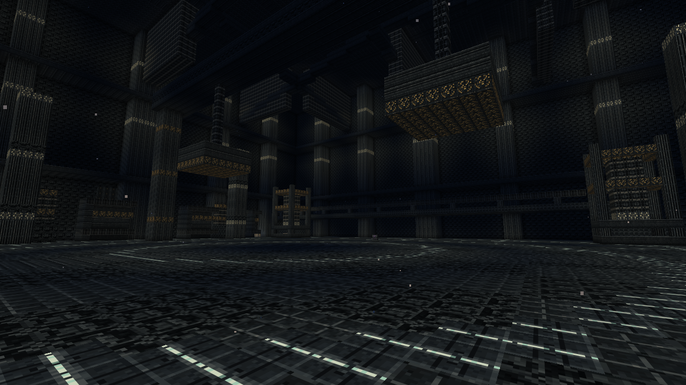

## Une galerie réellement rejointe par les escaliers

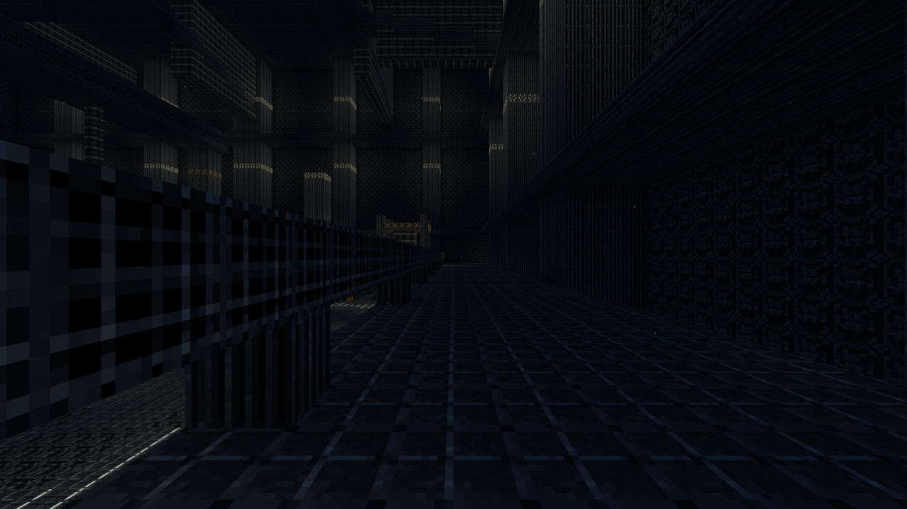

## Huit secteurs, progression et suivi des éliminations

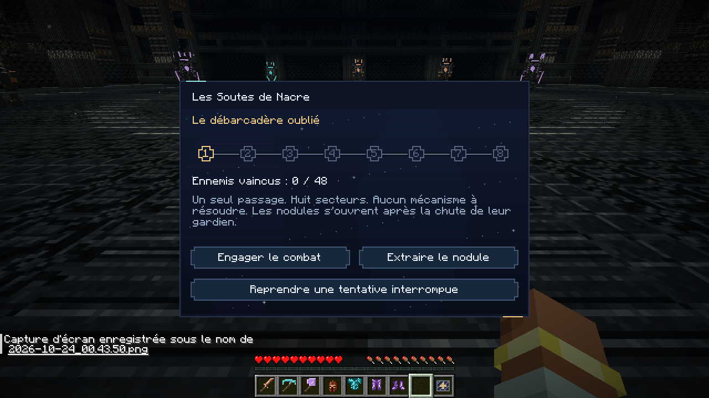

## Les chasseurs et sentinelles en combat réel

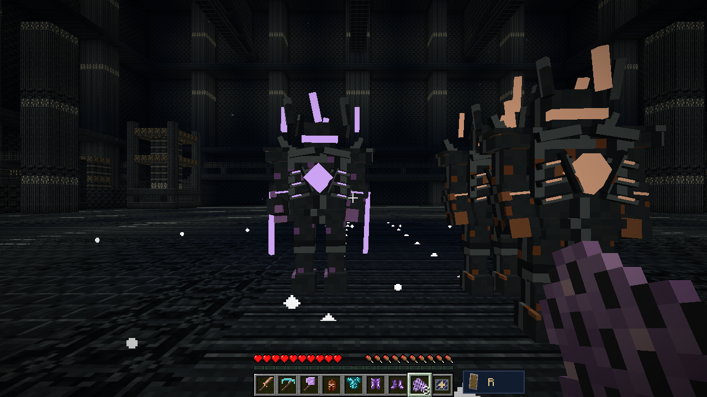

## Le Bastion, après ses vingt-quatre gardes

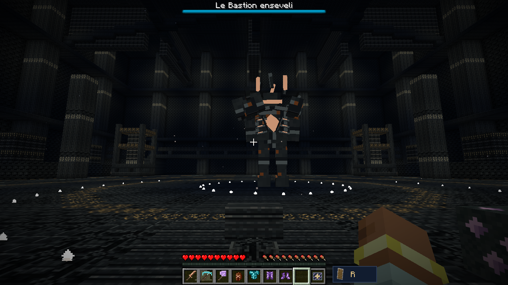

## Trois bruts d’astérium et un moteur, après la victoire

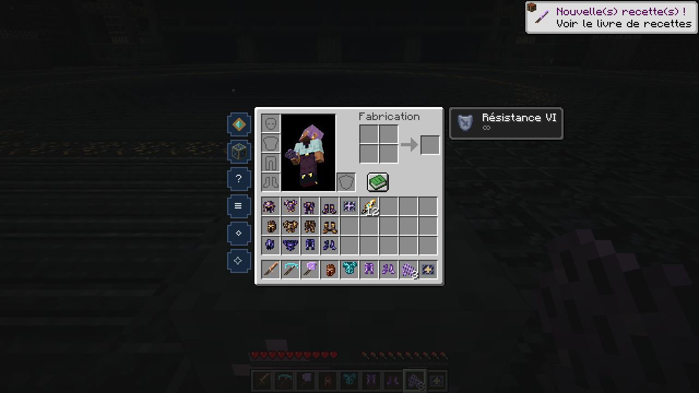

## Architecture de la Lentille noyée

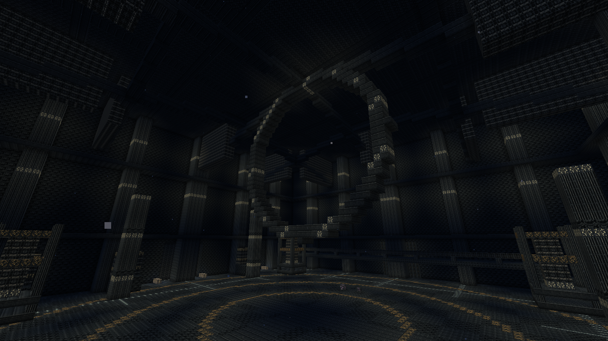

## Architecture de la salle du Souverain

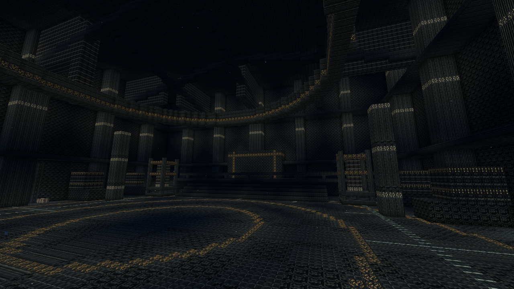

## Les sept contrôleurs, avec les assemblages de contrôle en arrière-plan

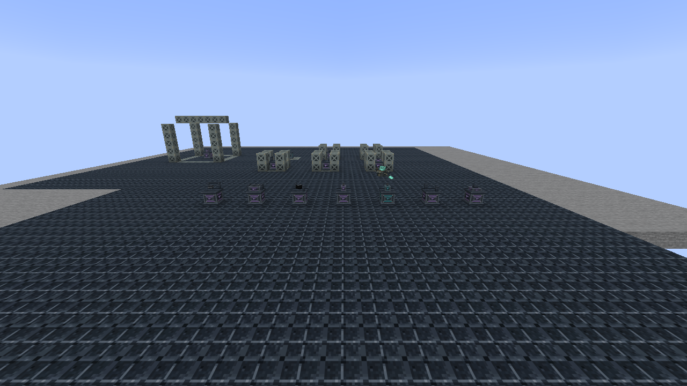

## Le derrick complet de la foreuse abyssale

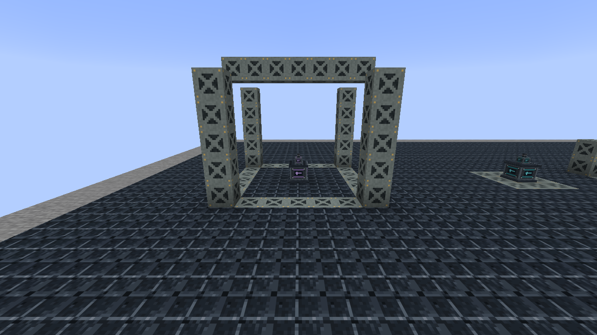

## Cycle actif, intégrité, entrées, produits et vingt-sept équipements

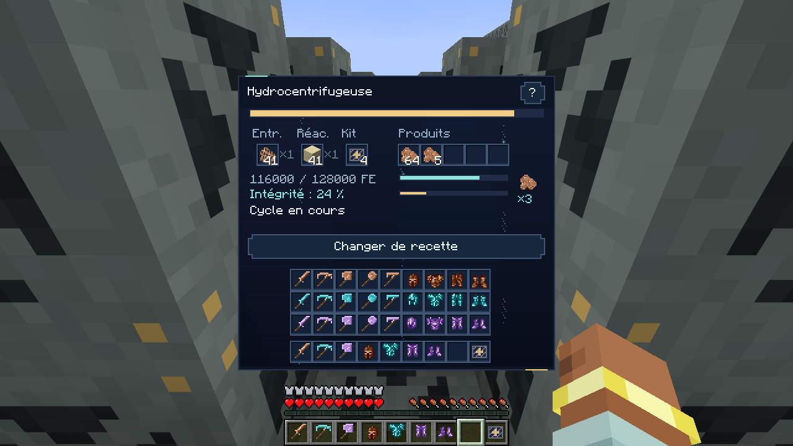

## Une aide de construction séparée de l’inventaire

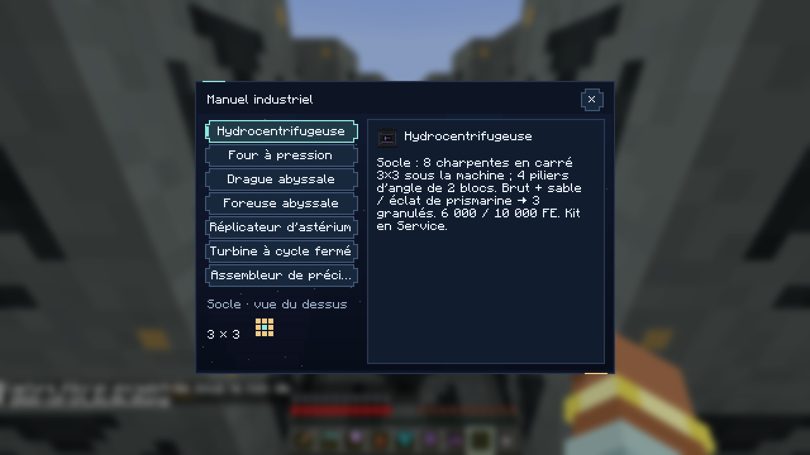

## Le montage 7 × 7 et ses véritables exigences

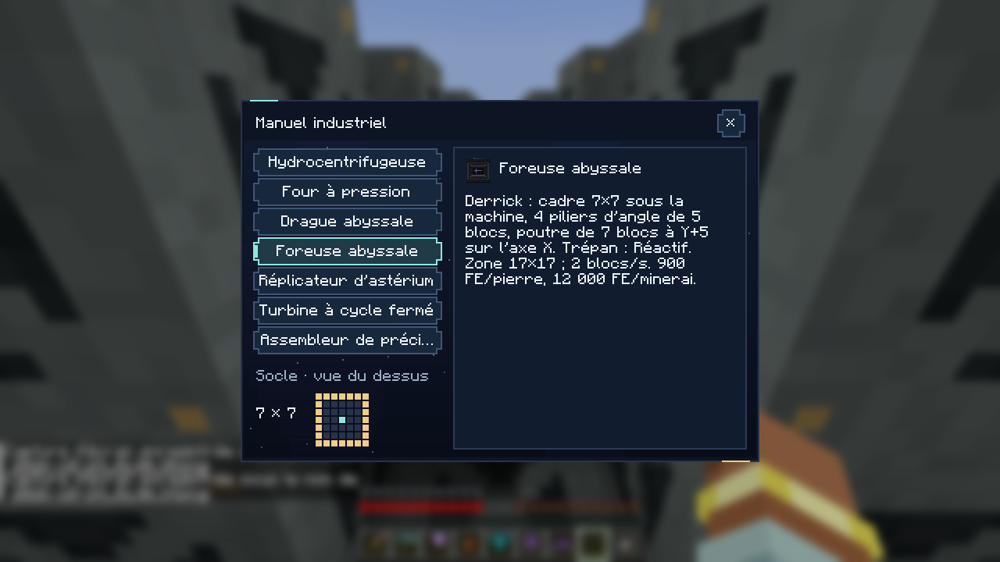

## L’interface native en fenêtre 854 × 480

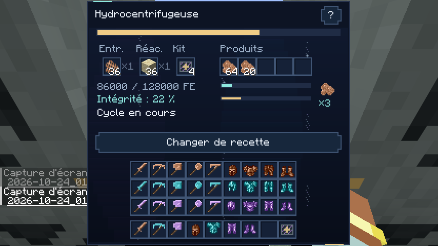

## L’aide de construction dans cette même petite fenêtre

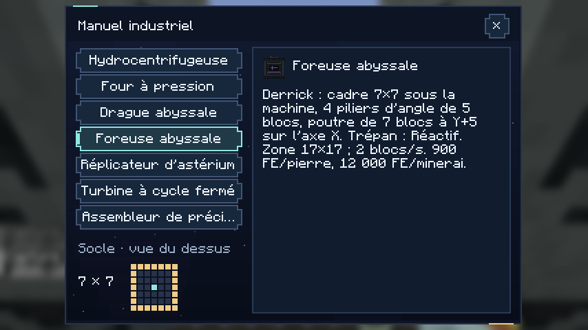

## L’armure d’astérium réellement portée et ses reliefs articulés

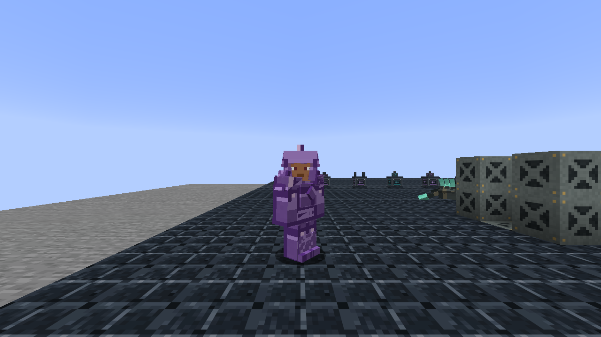

