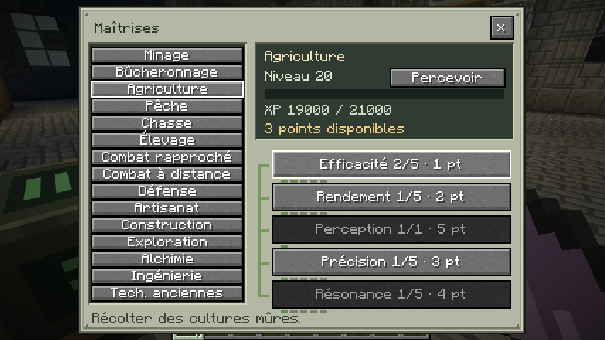
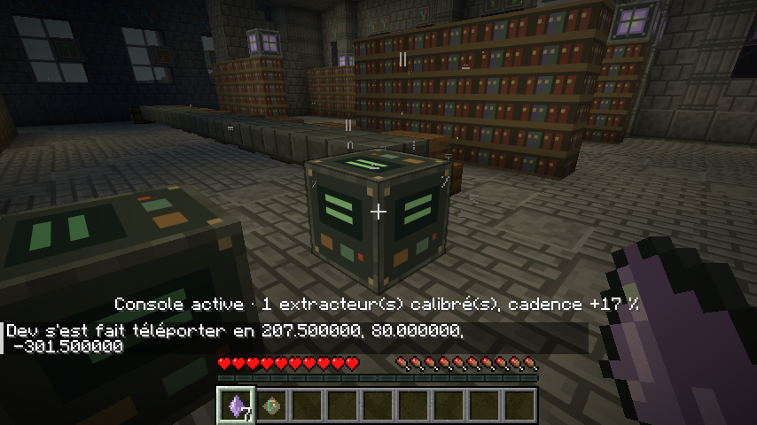
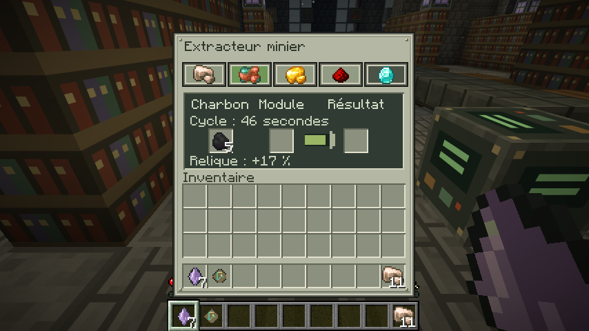

# Captures Minecraft — 0.3.0-dev

Captures F2 originales du vrai client Minecraft 26.2 / NeoForge 26.2.0.93, sans retouche.
Partie de validation : profil de démonstration niveau 20, injecté seulement dans cette partie locale pour contrôler les talents. Aucun XP offert à l’installation du mod.

## Agriculture : achat de talent et synchronisation

Le clic a fait passer Efficacité de 1 à 2 et les points disponibles de 4 à 3. Les quinze catégories sont jouables ; l’activité récompensée figure en bas de l’écran. Percevoir lance le talent actif sans livre.

## Console réparée en survie

La console de ce montage de validation a consommé un éclat résonant et remis un fragment de relique. Son bonus permanent de 17 % a été transmis à l’extracteur voisin (15 % de base + 2 % du talent). Le placement naturel dans les cinq modèles de bâtiments est contrôlé séparément.

## Cinq productions

Les icônes représentent fer, cuivre, or, redstone et diamant. Le cuivre a été sélectionné après le retrait du fer produit, sans conversion de la sortie. Le bonus de relique apparaît dans l’interface. Le diamant nécessite le module de stabilisation.

Les autres vues des bâtiments et des minerais sont conservées dans la [galerie 0.2](GALLERY_0.2.0.md).
