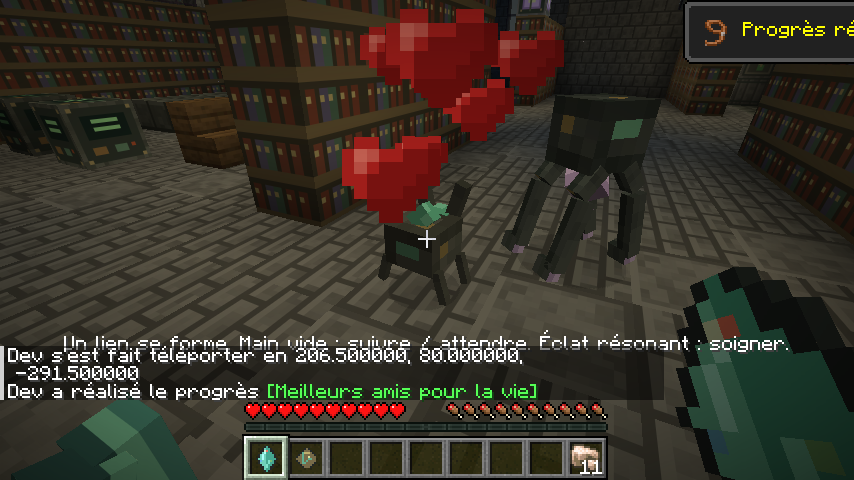
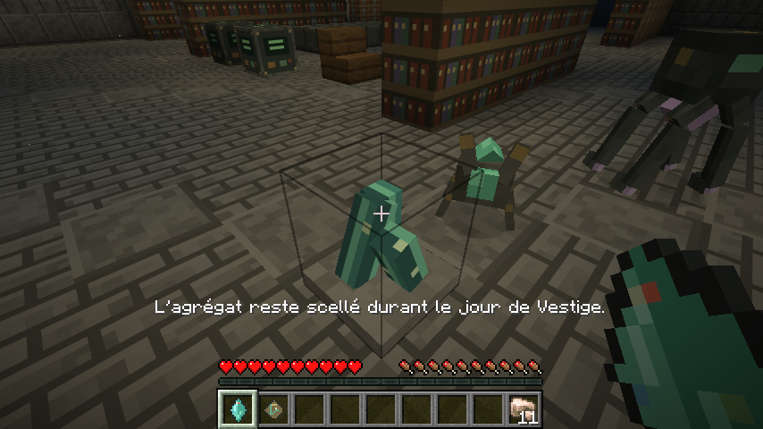
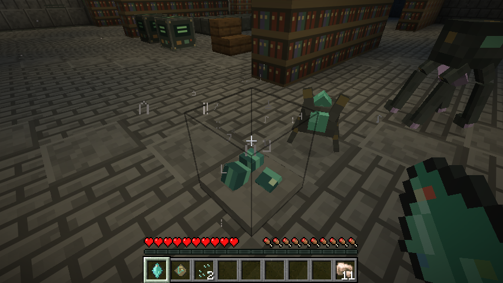
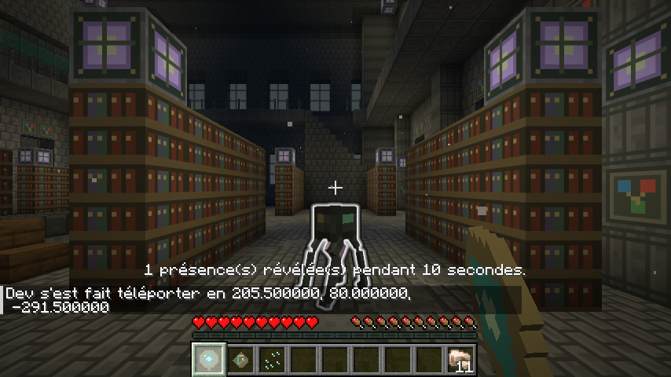

# Rencontres et échos — captures natives de la 0.4

Captures F2 du véritable client Minecraft Java 26.2, NeoForge 26.2.0.93. Les modèles et atlas 16 × 16 des deux créatures sont propres au mod.

Les entités et agrégats ont été placés par commande dans une partie de validation. Les interactions ont ensuite été effectuées en survie : ces images montrent leur fonctionnement et leur rendu, sans mesurer la fréquence naturelle des rencontres. L’archive visible provient de la génération du mod.

## Liaison du familier

Un cristal composite consommé en survie, cœurs d’apprivoisement et succès natif. Le fragment central devient vert une fois lié.

## Agrégat pendant le jour

La récolte est refusée le jour, sans perte de charge. La sentinelle et le familier montrent leurs silhouettes distinctes.

## Récolte nocturne

La même interaction pendant la nuit donne de la poussière d’écho ; le bloc reste en place et sa charge repart de zéro.

## Prisme d’écho

Une poussière consommée révèle les ennemis proches pendant dix secondes, avec le contour natif visible à travers les obstacles.

## Retour dans l’Overworld

Le familier apprivoisé accompagne son propriétaire lors du changement de dimension. Son UUID, sa propriété et sa présence proche ont été contrôlés par les commandes natives.

Ce trajet est également couvert par les tests serveur des trois dimensions vanilla, dont une destination initialement déchargée.

[Télécharger le JAR](https://github.com/axephir/TheNewDimension/raw/refs/heads/downloads/tnd-0.4.0-dev.jar) · [Description de la version](docs/ENCOUNTERS_0.4.0.md)
