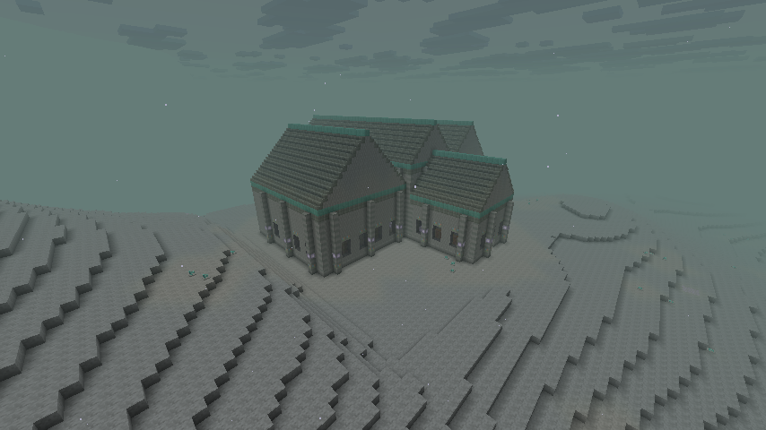
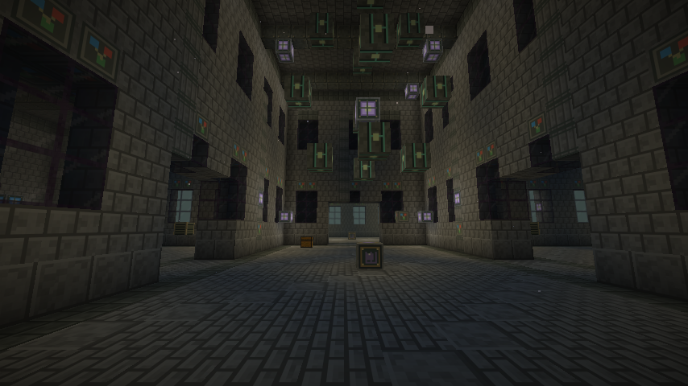
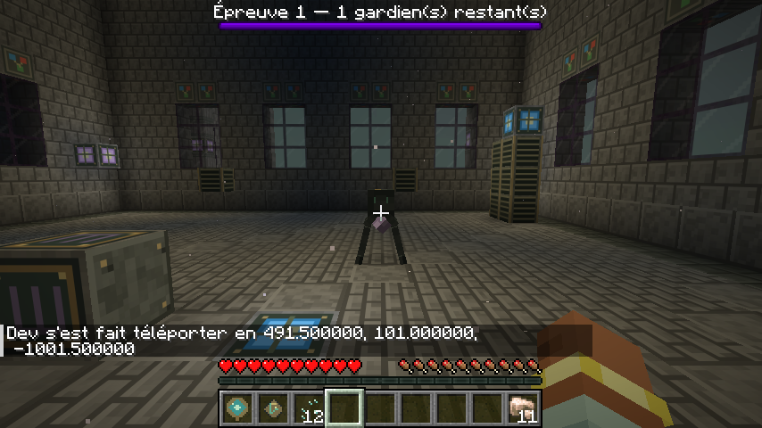
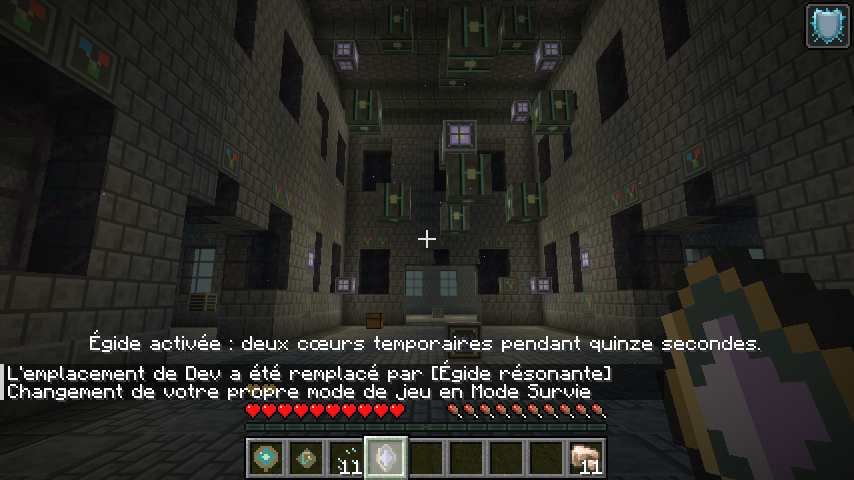

# Sanctuaire de résonance — 0.5.0-dev

Captures F2 natives du client Minecraft Java 26.2 / NeoForge 26.2.0.93. Ce sanctuaire a été trouvé avec la recherche native puis généré naturellement dans la partie de validation ; il n’a pas été placé par commande. Les commandes de déplacement et d’inventaire servent à préparer les contrôles. Les interactions des sceaux et de l’égide sont vérifiées en survie.

## Dans le paysage de Vestige

Cinq volumes imbriqués, toitures, fenêtres et contreforts ; emprise de 63 × 63 blocs. Les autres sites partagent sa grille de placement.

## La nef et son noyau suspendu

Les passages latéraux et celui du fond donnent accès aux trois épreuves. Les issues restent ouvertes.

## Activation d’une épreuve

Une poussière d’écho est consommée lors de l’activation en survie. Les gardiens utilisent les attaques annoncées des sentinelles et la barre native indique l’état de l’épreuve. Les tests serveur valident les trois vagues, les dégâts, les sauvegardes et l’unicité du trésor.

## Égide résonante

L’objet défensif accorde deux cœurs d’absorption pendant quinze secondes et consomme une poussière. Sa recharge native est d’une minute. L’exemplaire utilisé pour ce contrôle visuel a été fourni par commande ; la recette et la chaîne réelle de récompense sont contrôlées par les tests.

[Télécharger la 0.5](https://github.com/axephir/TheNewDimension/raw/refs/heads/downloads/tnd-0.5.0-dev.jar) · [Règles et limites](docs/DUNGEON_0.5.0.md)
