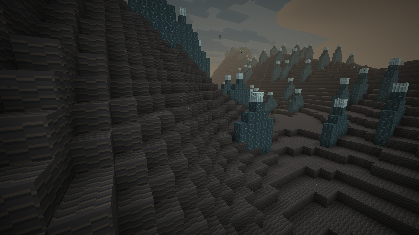
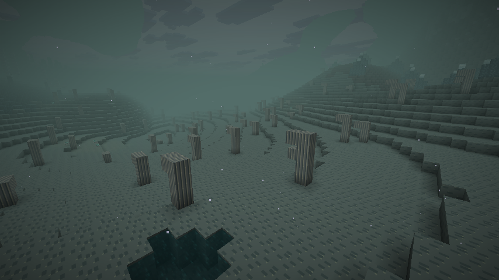
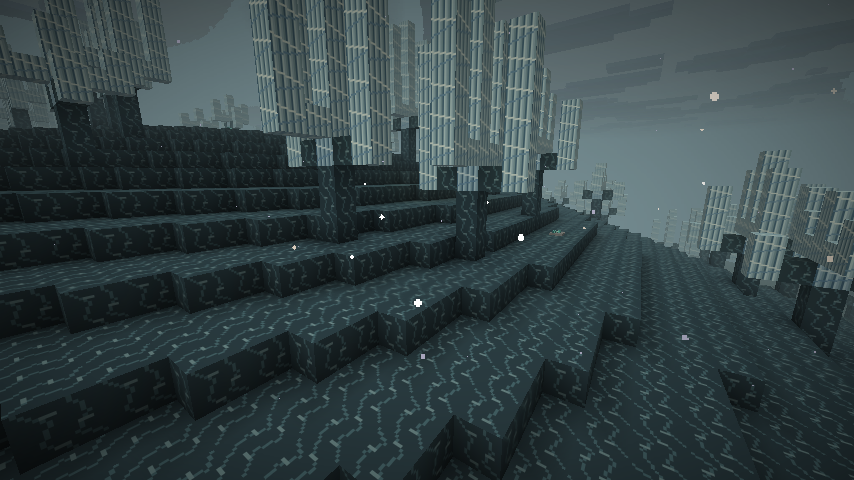
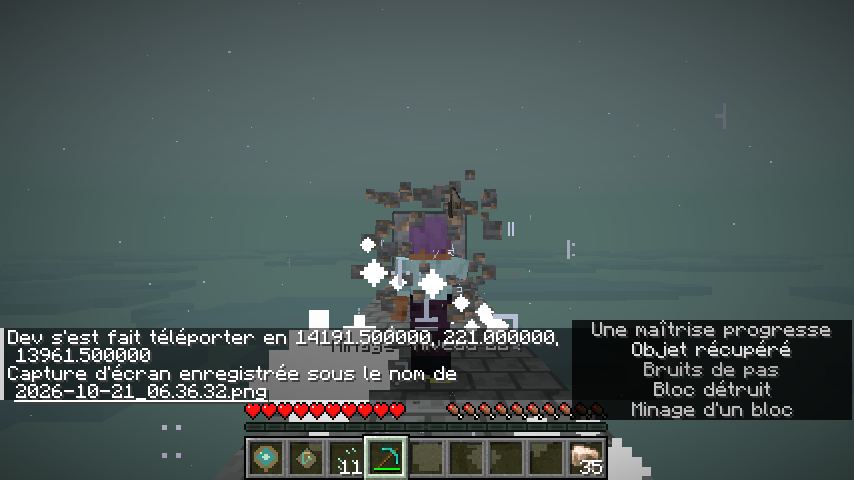

# Paysages et ambiance — 0.6.0-dev

Captures F2 natives de Minecraft Java 26.2 / NeoForge 26.2.0.93. Les trois paysages viennent de nouveaux chunks générés naturellement dans une partie de validation. Les déplacements et le réglage de l'heure sont effectués par commande pour préparer les vues. Aucun filtre ni pack de textures externe.

## Dunes vitrifiées

Reliefs ondulés, cendre vitrifiée et crêtes de pierre sombre, sous une brume plus chaude.

## Bassins de cendre

Limon, mares bordées et souches fossilisées. Le sous-titre montre un événement sonore local de ce biome.

## Forêt de verre

Formations cristallines ramifiées, pierre vitreuse et particules pâles. Le décor ne se limite pas à une modification de couleur.

## Montée de maîtrise

Spirale lumineuse et carillon, avec son sous-titre natif. Le minerai et la plateforme ont été placés par commande dans une zone de validation ; les blocs sont ensuite minés normalement en survie. Le profil de cette partie était déjà au niveau 20 : le multiplicateur d'XP a été temporairement augmenté pour ce contrôle visuel puis remis à sa valeur initiale. Les tests serveur vérifient les seuils et les déclenchements avec le multiplicateur normal.

[Écouter le montage des sons](https://github.com/axephir/TheNewDimension/raw/refs/heads/downloads/Vestige-0.6-audio-preview.ogg) · [Télécharger le JAR](https://github.com/axephir/TheNewDimension/raw/refs/heads/downloads/tnd-0.6.0-dev.jar)
