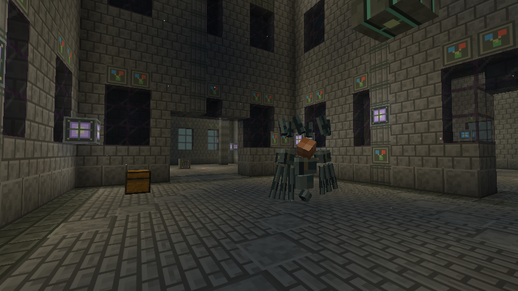
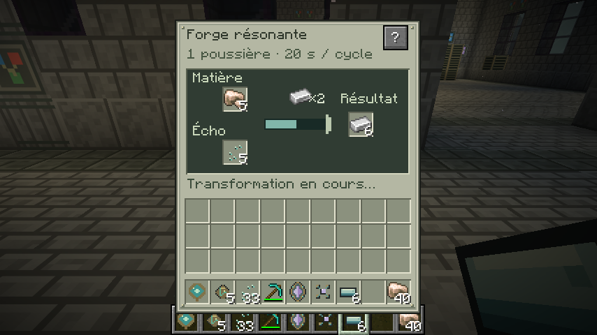
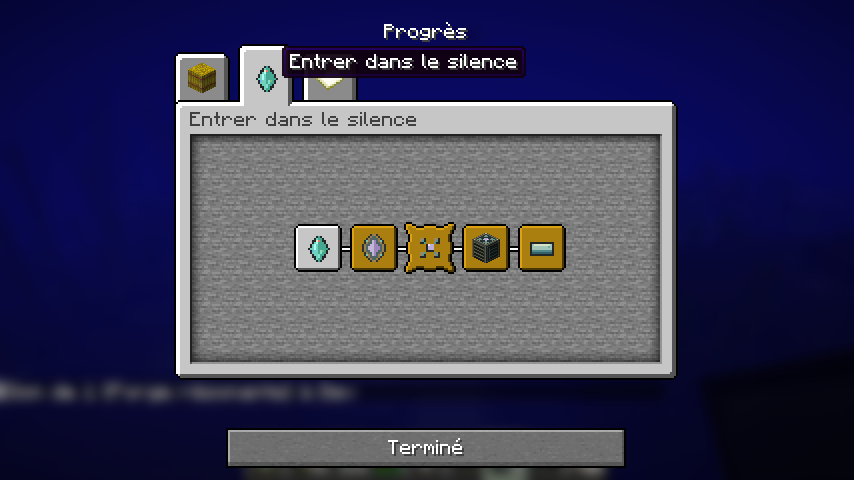

# The New Dimension — captures de la 0.7

Minecraft Java 26.2, NeoForge 26.2.0.93, client normal. Captures F2 originales en 854 × 480, sans retouche. Le monde de validation et les préparations par commandes ne sont pas inclus dans le téléchargement.

## Conservateur brisé

Couronne de fragments, mains articulées et cœur suspendu. La demi-vie a été préparée par commande pour montrer la deuxième phase. Le HUD est masqué pour cette vue du modèle. Les épreuves et l’invocation ont été préparées dans le sanctuaire de validation ; le clic d’invocation avec la poussière, les attaques, les fenêtres d’exposition et les sous-titres ont été vérifiés dans le client normal. Les dégâts, esquives et récompenses partagées sont aussi couverts par les tests natifs.

## Forge résonante

Inventaire physique, aperçu « ×2 », progression et sortie de deux lingots après un vrai cycle. L’inventaire du joueur contient la matrice et les six alliages du trésor du boss. Les matières de test ont été insérées par commandes. Le bouton « ? » explique les quatre transformations, les entonnoirs et la pause redstone.

## Progrès natifs

Les cinq objectifs relient Vestige, le sanctuaire, le Conservateur, la forge et l’alliage trempé. Les acquisitions et déplacements du monde de validation comprennent des commandes ; cette galerie ne représente pas une partie de survie sans assistance.

[Télécharger le JAR](tnd-0.7.0-dev.jar) · [Guide de progression](docs/EXPEDITION_0.7.0.md) · [Écouter les six nouveaux sons](Vestige-0.7-gameplay-preview.ogg)

Les [paysages et sons de la 0.6](GALLERY_0.6.0.md) restent inclus.
