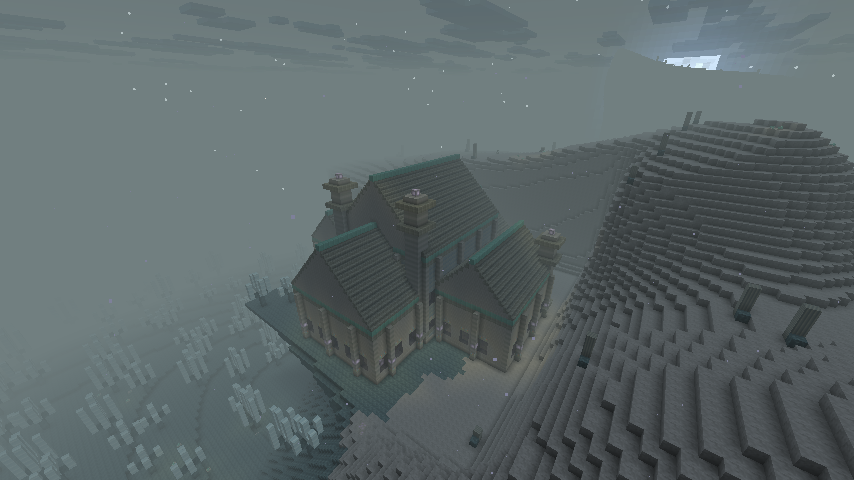
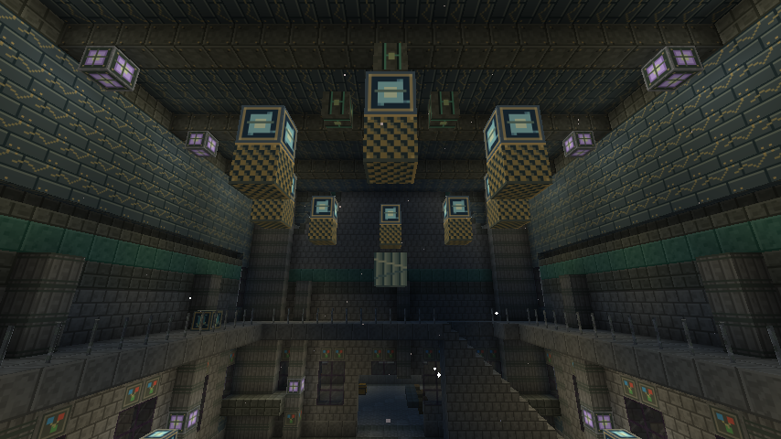
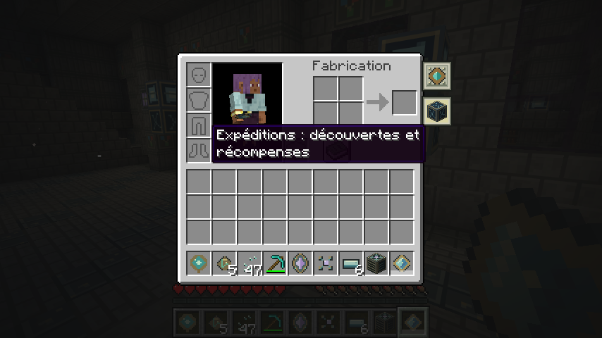
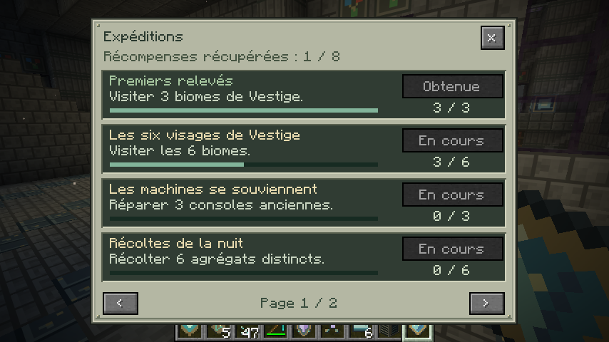
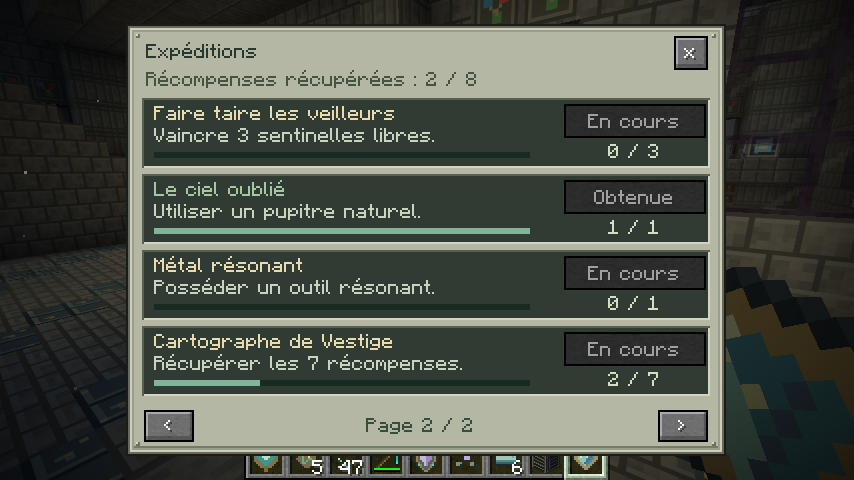

# Observatoires et expéditions — TND 0.8.0-dev

[Télécharger le JAR](tnd-0.8.0-dev.jar) · [Guide de la version](docs/FIELDWORK_0.8.0.md) · [Validation](VALIDATION-0.8.0.txt)

Captures F2 originales du client Minecraft Java 26.2 / NeoForge 26.2.0.93, sans retouche. Le monde de validation est préparé avec des commandes : déplacements, équipement et caméra Spectateur pour l’architecture. Les notes et les récompenses montrées sont enregistrées par les actions du joueur en mode Survie. Ces images ne représentent pas une progression sans assistance.

## Un observatoire naturel dans Vestige

Septième bâtiment du mod, 63 × 43 × 63 blocs, trouvé dans de nouveaux chunks avec la commande native `/locate structure tnd:observatory`. Bibliothèque, dortoir, atelier, archive, nef et galerie à l’étage.

## Le mécanisme céleste suspendu

Carreaux célestes, cartes, lampes, treillis de laiton et galerie accessible par un escalier. Le pupitre se trouve au rez-de-chaussée ; deux ancres permettent de préparer les longs voyages.

## Les objectifs depuis l’inventaire

Le second onglet, sous les maîtrises, ouvre les huit expéditions. Aucun livre à porter. Les pupitres et `/tnd expeditions` donnent accès au même écran.

## Une récompense après trois biomes

La visite en Survie de trois biomes différents remplit le premier objectif. Sa récompense vient d’être récupérée : le bouton indique « Obtenue », puis refuse toute nouvelle distribution. Les infobulles précisent les récompenses et les biomes déjà visités.

## La découverte du site compte aussi

Le pupitre naturel valide « Le ciel oublié ». Deux récompenses ont été récupérées dans ce parcours de vérification ; les autres objectifs restent à accomplir. Le trophée final demande les sept premières récompenses.

Le prisme de retour a été testé depuis plus de huit kilomètres : chunk de l’ancre déchargé avant la canalisation, arrivée sûre dans l’observatoire et consommation de deux poussières, de 49 à 47. Les annulations, les ancres remplacées et les arrivées obstruées sont également couvertes par les tests Minecraft.

[Galerie 0.7 : boss, forge et équipement](GALLERY_0.7.0.md) · [Galerie 0.6 : biomes et ambiance](GALLERY_0.6.0.md)
