# Vestige 0.9 — captures en jeu

Client Minecraft 26.2 / NeoForge 26.2.0.93. Captures natives F2, sans retouche. Monde de validation : caméras spectateur et préparation des rencontres/ateliers par commandes ; nuages désactivés pour les vues extérieures. Les combats et interfaces utilisent les systèmes du mod. Les intérieurs gardent les mêmes plans dans les anciens et les nouveaux bâtiments.

[Télécharger le JAR](https://github.com/axephir/TheNewDimension/raw/refs/heads/downloads/tnd-0.9.0-dev.jar) · [Guide de jeu](https://github.com/axephir/TheNewDimension/blob/downloads/docs/AWAKENING_0.9.0.md)

## Citadelle auréole — bâtiment central, couronne et massif

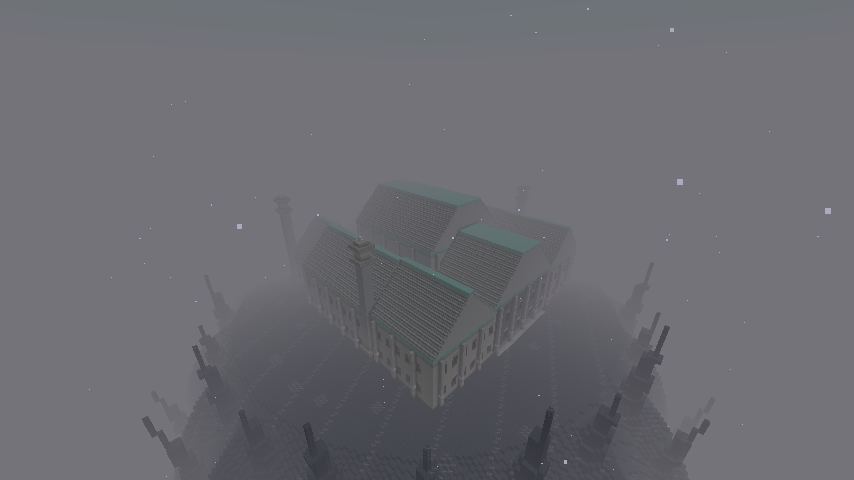

## Couronne et aiguilles de scorie ferrenoire

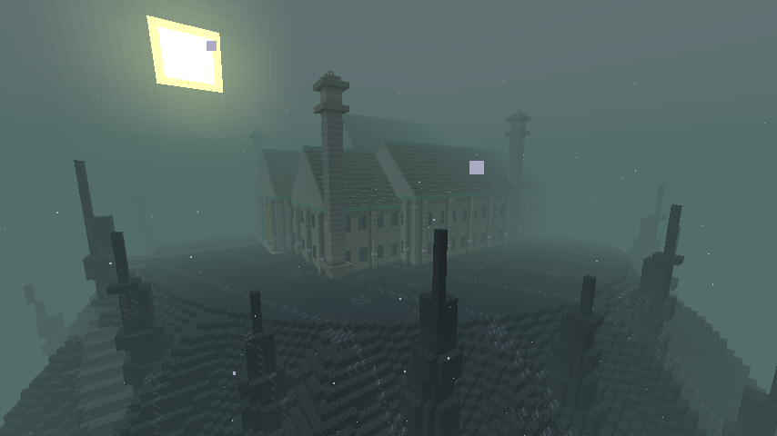

## Avant-poste de l’Overworld en biome enneigé

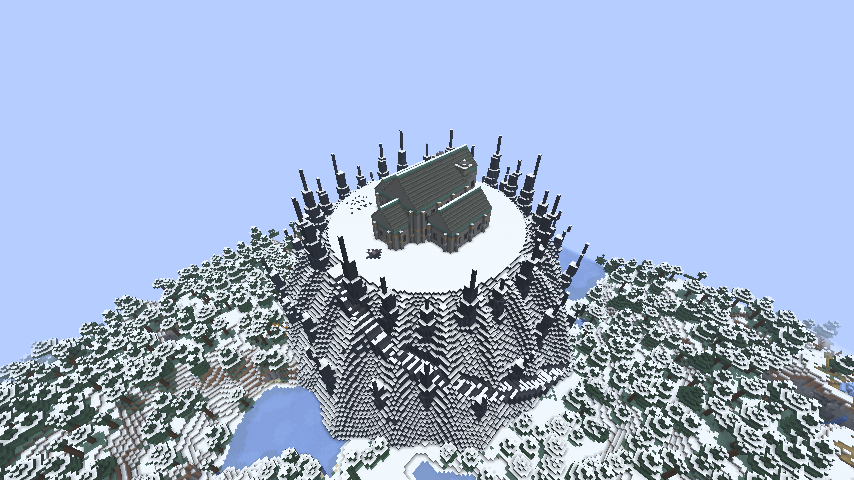

## Nef de la citadelle, colonnes et galeries

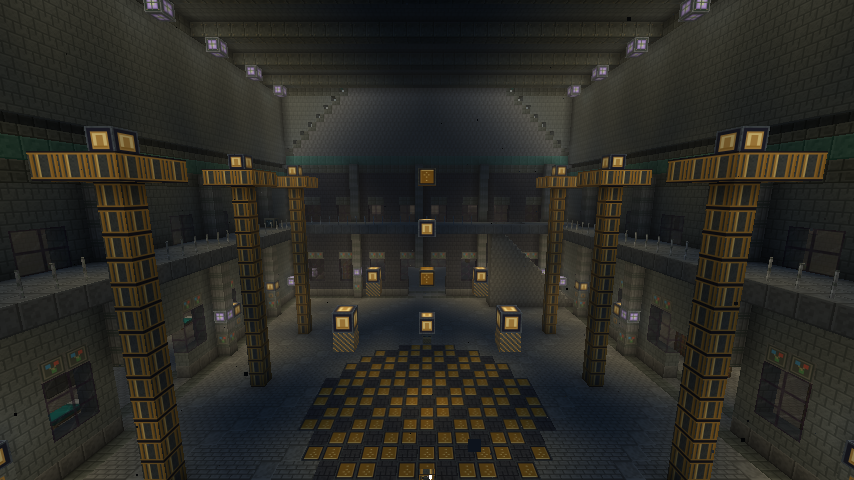

## Conservatoire d’écho et sa couronne

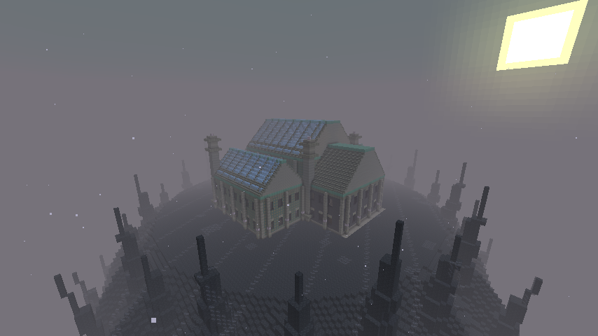

## Verrières et orgue minéral

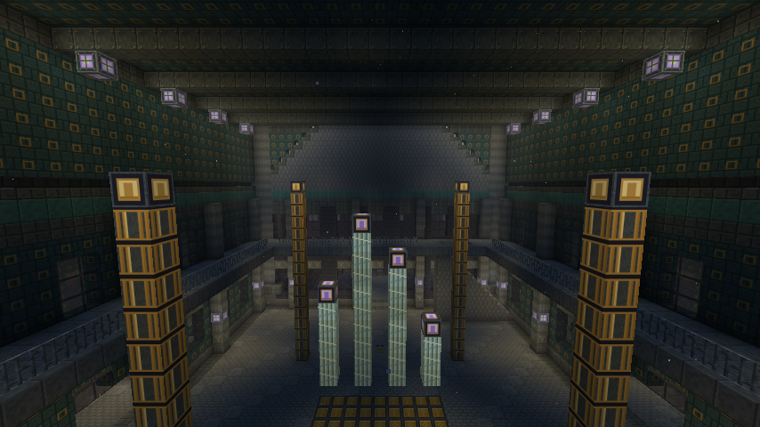

## Armure ombrale en relief, onglets à gauche et effets à droite

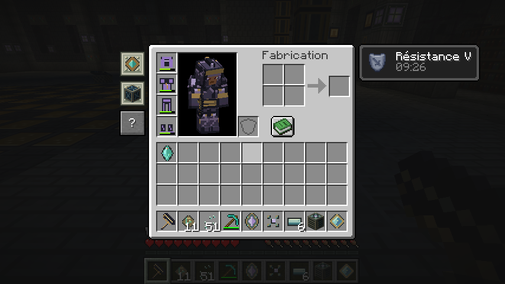

## Les onglets suivent aussi le livre de recettes

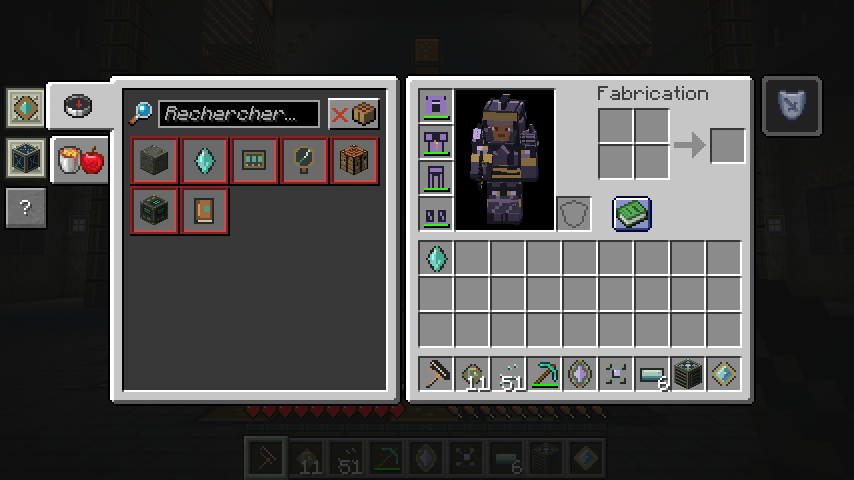

## Guide intégré, page des machines

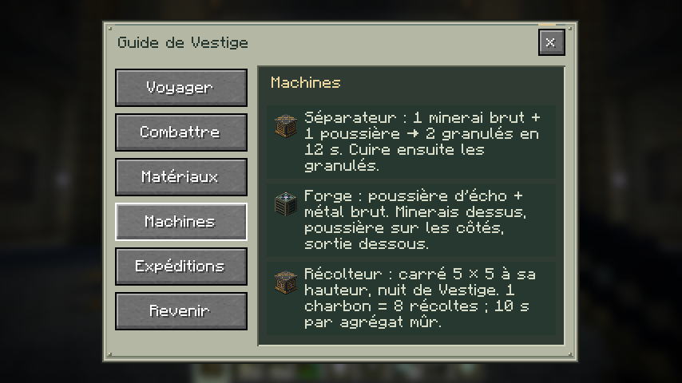

## Lithogarde : modèle articulé et attaque annoncée

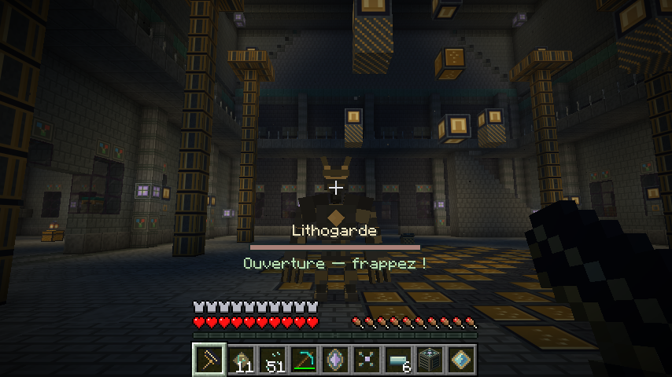

## Traqueur de verre, carapace et mandibules

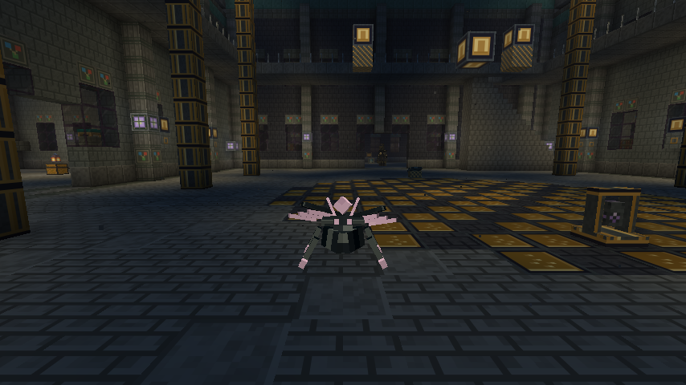

## Séparateur : interface et production native

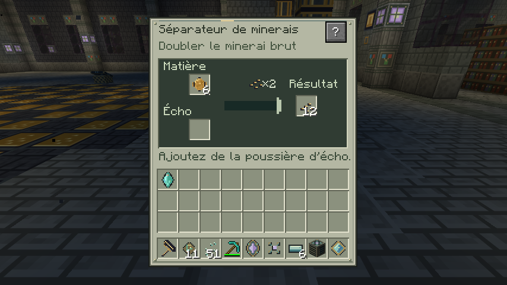

[Voir le Lithogarde en mouvement](https://github.com/axephir/TheNewDimension/raw/refs/heads/downloads/Vestige-0.9-lithoguard.mp4) (capture native, sans piste audio).

[Écouter les seize nouveaux effets](https://github.com/axephir/TheNewDimension/raw/refs/heads/downloads/Vestige-0.9-gameplay-preview.ogg) (montage des fichiers distribués).
